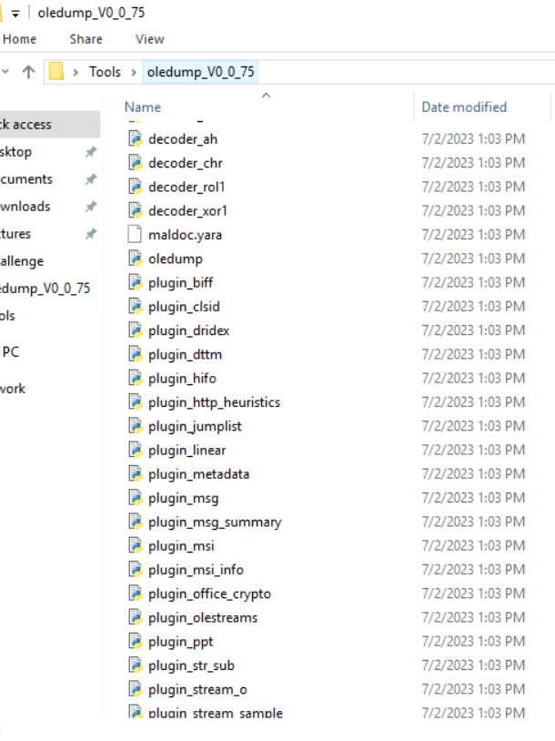
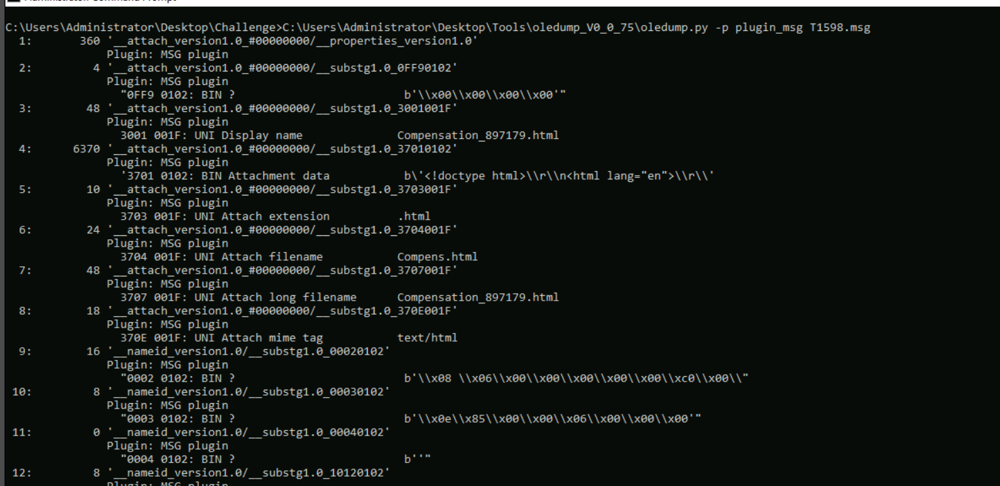
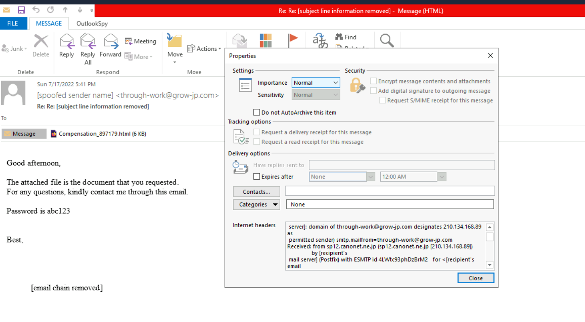
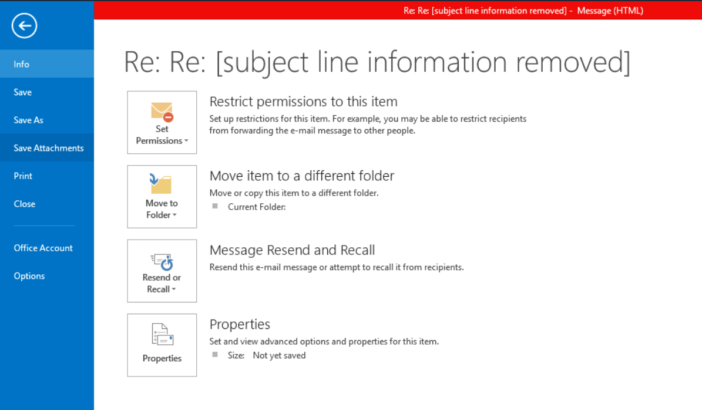
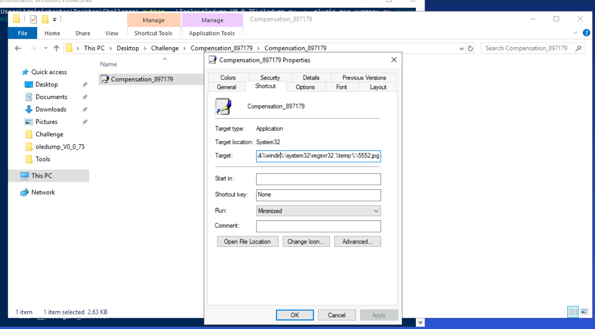

# Dragonfly — Investigating a phishing email from `.msg` to `.lnk`

**Lab:** [CyberDefenders — T1598.002 Dragonfly](https://cyberdefenders.org/blueteam-ctf-challenges/t1598002-dragonfly/)  
**Environment:** Windows lab VM  
**Tools:** Microsoft Outlook, Didier Stevens' `oledump.py`, Windows File Explorer, PowerShell

## Overview

The Dragonfly exercise begins with an Outlook message (`T1598.msg`) containing an HTML attachment presented as a requested document. The attachment leads to a password-protected ZIP archive containing a Windows shortcut (`.lnk`). The investigation follows that chain, from the email and its transport headers to the shortcut's Target field.

The analysis uses two complementary methods: **Outlook for message-level inspection** and **`oledump.py` for the underlying MSG streams and MAPI properties**. The extracted ZIP is hashed with PowerShell, and the shortcut is examined through its Properties dialog without launching it.

The suspicious HTML was opened only inside the isolated lab environment, as required by the exercise. The `.lnk` file was **not executed**.

## 1. Examine the email in Outlook

Opening `T1598.msg` in Outlook provides the initial context:

- Sender address: `through-work@grow-jp.com`
- Subject: a reply-style subject beginning `Re: Re:`
- Attachment: `Compensation_897179.html`
- Message text: a claim that the attached file is the requested document, plus the password `abc123`

The attachment is HTML rather than a conventional office document. That is worth examining because an HTML file can include links and scripts, even when the email describes it as a document.

Outlook is also useful for reviewing the Internet headers and saving the attachment. Those operations do not require extracting individual MSG streams.

### Relevant theory — `.msg`, MIME, and OLE storage

An **Outlook `.msg` file** is a saved Outlook item. It can store the email body, recipients, sender details, attachments, and other metadata. This particular MSG file uses **OLE Compound File** storage, which organises data in *storages* and *streams*. A storage acts like a directory inside the compound file; a stream holds a sequence of bytes.

A typical **`.eml` file**, by contrast, usually contains an Internet email in RFC 5322/MIME format. Its headers and MIME boundaries are often directly readable as text.

**MIME** (*Multipurpose Internet Mail Extensions*) enables messages to carry different body formats and attachments. A MIME type such as `text/html` describes the declared format of a file or message part. It does not establish whether the content is safe.

## 2. Examine MSG streams using `oledump.py`

The lab includes Didier Stevens' `oledump.py` and several plugins. `plugin_msg` interprets Outlook-specific stream names and property tags.



From the `Challenge` directory:

```cmd
python ..\Tools\oledump_V0_0_75\oledump.py -p plugin_msg T1598.msg
```

`-p plugin_msg` loads the MSG plugin. The tool enumerates streams and adds labels to recognised MAPI properties. An attachment-related entry appears as:

```text
7: 48 '__attach_version1.0_#00000000/__substg1.0_3707001F'
   Plugin: MSG plugin
   3707 001F: UNI Attach long filename    Compensation_897179.html
```



The stream number (`7`) is an index in this particular tool output. The more useful identifier is `3707001F`, which describes what the property stores.

### Relevant theory — MAPI properties and property tags

**MAPI** stands for *Messaging Application Programming Interface*. MAPI properties represent fields associated with an Outlook item: subject, sender, message class, message body, attachment filename, attachment bytes, and many others.

A MAPI property tag is made of two hexadecimal values:

| Component | Value | Meaning |
| --- | --- | --- |
| Property ID | `3707` | Attachment long filename (`PR_ATTACH_LONG_FILENAME`) |
| Property type | `001F` | Unicode string |
| Full tag | `0x3707001F` | Property ID and type together |

The prefix `0x` identifies hexadecimal notation; it is not an additional byte in the tag. Another common type, `0102`, identifies binary data.

The useful streams in `T1598.msg` include:

| Stream | MAPI tag | Content |
| --- | --- | --- |
| 4 | `37010102` | Binary attachment data |
| 7 | `3707001F` | Long attachment filename: `Compensation_897179.html` |
| 8 | `370E001F` | Attachment MIME type: `text/html` |
| 28 | `007D001F` | Transport message headers |
| 38 | `1000001F` | Plain-text message body |

Stream indices may differ in another MSG file. The MAPI identifiers describe the properties independently of their position in the listing.

For example, stream 4 can be extracted directly:

```cmd
python ..\Tools\oledump_V0_0_75\oledump.py -s 4 -d T1598.msg > attachment.html
```

Here `-s 4` selects the stream, `-d` writes its raw bytes, and `>` redirects them to a file. For raw binary redirection in this older Windows environment, **Command Prompt** is preferable to Windows PowerShell 5.1, whose output redirection can change byte encodings. In this investigation the attachment was saved using Outlook instead.

### Relevant theory — Outlook message classes

Every Outlook item has a **message class** describing what kind of item it is. The class in this file is `IPM.Note`, the standard class for an email message. It is an item-type identifier, not a determination of legitimacy.

Other common examples are:

| Message class | Item type |
| --- | --- |
| `IPM.Note` | Email message |
| `IPM.Appointment` | Calendar appointment |
| `IPM.Schedule.Meeting.Request` | Meeting request |
| `IPM.Contact` | Contact |
| `IPM.Task` | Task |
| `IPM.StickyNote` | Outlook note |

Applications may also use specialised or custom message classes. During analysis, the class helps identify the sort of Outlook object being processed and can inform how it should be parsed.

## 3. Trace the message through its headers

Outlook exposes the complete transport headers under **File → Properties → Internet headers**.



The relevant portion identifies the final public sending server:

```text
Received: from sp12.canonet.ne.jp
 (sp12.canonet.ne.jp [210.134.168.89])
 by [recipient's mail server] (Postfix) ...
 Mon, 27 Jun 2022 16:34:49 +0000 (UTC)
```

An earlier entry records an SMTP submission client:

```text
Received: from localhost
 (wsip-68-109-200-102.mc.at.cox.net [68.109.200.102])
 by smtp12.canonet.ne.jp (Postfix) with ESMTPSA ...
 Tue, 28 Jun 2022 01:34:46 +0900 (JST)
```

The two IP addresses play different roles. `210.134.168.89` was the public mail relay that delivered the message to the recipient's server (and the IP expected by the lab). `68.109.200.102` appears as an earlier submission client. Private `172.21.x.x` addresses in other headers belong to intermediate infrastructure. An IP address in a mail route should not automatically be identified as the attacker's device.

### Relevant theory — How `Received` headers work

A mail server normally prepends a `Received` header when it accepts a message. As a result, the newest entry appears near the top and the earlier hops appear farther down. Reading **from bottom to top** helps reconstruct the route.

Important fields include:

- **`From`** — the sender identity presented to the recipient; it can be falsified.
- **`Return-Path`** — the SMTP envelope sender recorded for bounce handling; it need not match `From`.
- **`Received`** — transfer records added by mail servers, including servers, timestamps, and sometimes IP addresses.
- **`Authentication-Results`** — the receiving system's reported email-authentication checks.

Headers supplied before the message enters trusted infrastructure can be forged. Assessing the route requires attention to which servers are trusted and which are merely named in untrusted header text.

### Calculate the recorded delivery interval

The earliest visible SMTP submission occurred at **28 June 2022, 01:34:46 JST** (`UTC+09:00`). Converted to UTC, that is **27 June 2022, 16:34:46**.

The recipient's server accepted the message at **27 June 2022, 16:34:49 UTC**. The interval between those recorded events is **3 seconds**.

This measures the visible SMTP transit interval, not the time from composing the email to the recipient opening it.

### Relevant theory — SPF, DKIM, DMARC, and mail filtering

The message's `Authentication-Results` header reports:

```text
spf=pass; dkim=none; dmarc=none
```

These checks serve different purposes:

| Mechanism | What it checks | Interpretation in this case |
| --- | --- | --- |
| **SPF** | Whether the connecting server is authorised for the SMTP envelope-sender domain | `pass` — the recipient accepted the sending server as authorised |
| **DKIM** | Whether a domain's cryptographic signature validates the message | `none` — no applicable DKIM signature was reported |
| **DMARC** | Whether SPF/DKIM authentication aligns with the visible From domain, under the domain's policy | `none` — no positive DMARC authentication verdict was reported |

SPF passing does not demonstrate that a message is benign; an attacker can send harmful content through a server authorised for a domain.

The headers also contain:

```text
X-Virus-Scanner: This message was checked by ESET Mail Security
X-ESET-Antispam: OK
```

These fields identify ESET mail-security components used along the delivery path. Spam filtering and malware detection overlap but are not the same task. The presence of a scanner result indicates that a check took place, not that the attachment is harmless.

## 4. Save the HTML attachment and examine the ZIP

The attachment was saved using **Outlook → File → Save Attachments**, without having to extract stream 4 manually.



Inside the isolated lab VM, opening `Compensation_897179.html` caused a ZIP archive to download. The archive was password-protected, and the email body supplied the password: `abc123`. After extraction, the archive contained a Windows shortcut.

### Relevant theory — HTML attachments and encrypted archives

HTML can display text and formatting, but it can also contain JavaScript and refer to remote content. As an email attachment, it may serve as an intermediate stage that retrieves another file instead of delivering the purported document directly.

Password protection can make automatic inspection harder for security products that cannot decrypt an archive. Neither HTML attachments nor encrypted ZIP files are inherently malicious; their significance comes from content and behaviour. In this exercise, the HTML-to-ZIP transition was observed in the lab.

### Calculate the ZIP's MD5 hash

PowerShell includes `Get-FileHash`:

```powershell
Get-FileHash .\downloaded.zip -Algorithm MD5
```

Replace `downloaded.zip` with the actual archive filename. The resulting digest for this lab's ZIP was:

```text
7e42f69b2adce7166408f635a093266e
```

**What a file hash establishes:** A cryptographic hash produces a fixed-length digest from file content. Analysts can compare it against known artifacts or other copies. Hashing the email, HTML attachment, ZIP, and shortcut would produce different digests because they are different byte sequences.

MD5 is still encountered in malware indicators and older exercises, but it has known collision weaknesses. SHA-256 is preferable for security-sensitive integrity comparisons:

```powershell
Get-FileHash .\downloaded.zip -Algorithm SHA256
```

A hash alone neither proves nor disproves that a file is malicious.

## 5. Inspect the shortcut's Target field

The extracted ZIP contained a Windows shortcut (`.lnk`). Rather than opening it, the shortcut was inspected through **right-click → Properties → Shortcut → Target**.



The Target references `regsvr32` and a `.jpg`-named file under the temporary directory. The investigation also identified the URL associated with the shortcut:

```text
http://23.29.125.210/herALook.dat
```

The URL is an investigation artifact, not a destination to visit. The available Target screenshot shows only part of the command, so the precise full command-line sequence is not reproduced here. The shortcut was inspected statically and not executed.

### Relevant theory — `.lnk` files and living-off-the-land binaries

A Windows **`.lnk` file** stores shortcut metadata: the target application or file, optional command-line arguments, working directory, icon information, and other properties. A shortcut therefore may be more than a convenient pointer to a document—it can cause Windows to run a command.

`regsvr32.exe` is a legitimate Windows utility used to register and unregister COM components. It is also a **living-off-the-land binary** (LOLBin): a built-in operating-system tool that can be abused as part of a malicious command chain.

The `.jpg` extension in the Target does not guarantee that the referenced content is a JPEG image. The extension is a filename convention, not a file-content verification method.

Inspecting the Target field is a useful first step. A deeper examination could parse the `.lnk` structure and its complete command-line arguments, then correlate those details with process creation and network telemetry if available. No execution or compromise is established by this static artifact alone.

## 6. Reconstructed delivery chain

The artifacts observed in the lab form the following sequence:

```text
Outlook message (T1598.msg)
    └── HTML attachment (Compensation_897179.html)
          └── Password-protected ZIP download
                └── Windows shortcut (.lnk)
                      └── Target references a Windows utility and remote URL
```

The key investigative distinction is between **delivery evidence** and **execution evidence**. The email, attachment, ZIP, and shortcut establish a delivery chain. Establishing that a recipient launched the shortcut, that a command ran, or that a host was compromised would require separate endpoint or network artifacts.

For this type of investigation, the most direct workflow is to use Outlook for the message and headers, `oledump.py` for MAPI/stream inspection, PowerShell for hashing, and static file inspection for the shortcut. Each tool addresses a different evidence source.

## References

- [CyberDefenders — Dragonfly (T1598.002)](https://cyberdefenders.org/blueteam-ctf-challenges/t1598002-dragonfly/)
- [Didier Stevens Suite — `oledump.py` and MSG plugins](https://github.com/DidierStevens/DidierStevensSuite)
- [Microsoft — PidTagAttachLongFilename](https://learn.microsoft.com/en-us/office/client-developer/outlook/mapi/pidtagattachlongfilename-canonical-property)
- [Microsoft — Message classes and MAPI properties](https://learn.microsoft.com/en-us/office/client-developer/outlook/mapi/message-classes)
