# FalconEye — Active Directory compromise investigation

**CyberDefenders · Splunk SIEM · Windows Security · Sysmon · PowerShell · DFIR**  
**Evidence window:** 8–10 May 2023 · **Primary compromised host:** `CLIENT02` · **Splunk index:** `folks`

An Active Directory intrusion traced through process creation, PowerShell script blocks, Windows logon sessions, Kerberos ticket requests, and execution on a second workstation. The available evidence shows AD reconnaissance, service-path interception, Mimikatz and Rubeus activity, credential misuse, and remote execution. Each conclusion below follows from the recorded events; attempted actions are distinguished from confirmed outcomes.

[CyberDefenders — FalconEye](https://cyberdefenders.org/blueteam-ctf-challenges/falconeye/) · [Windows/AD tool recognition reference](references/windows-ad-tools.md)

## Contents

1. [Environment and telemetry](#1-environment-and-telemetry)
2. [Attack timeline](#2-attack-timeline)
3. [NewCredentials logons — finding the initial account and host](#3-newcredentials-logons--finding-the-initial-account-and-host)
4. [BloodHound PowerShell enumeration](#4-bloodhound-powershell-enumeration)
5. [Unquoted service path and privilege escalation](#5-unquoted-service-path-and-privilege-escalation)
6. [Executable hashes and payload staging](#6-executable-hashes-and-payload-staging)
7. [Mimikatz execution and DCSync](#7-mimikatz-execution-and-dcsync)
8. [Kerberos key reuse: Mohammed and it-support](#8-kerberos-key-reuse-mohammed-and-it-support)
9. [Kerberos delegation abuse targeting CLIENT03](#9-kerberos-delegation-abuse-targeting-client03)
10. [Confirming WinRM execution on CLIENT03](#10-confirming-winrm-execution-on-client03)
11. [Forged tickets and access to the parent domain](#11-forged-tickets-and-access-to-the-parent-domain)
12. [Investigation results and remaining uncertainties](#12-investigation-results-and-remaining-uncertainties)
13. [Technical references](#13-technical-references)

---

## 1. Environment and telemetry

Splunk's Data Summary shows five Windows hosts: `ALI`, `ABDULLAH`, `CLIENT01`, `CLIENT02`, and `CLIENT03`. The Windows data resides in **`index=folks`**, with sources for Security, Sysmon, PowerShell Operational, System, and Application logs. `ABDULLAH` records child-domain controller authentication events; the attacker later targets the parent domain `Ali.Alhakami`.

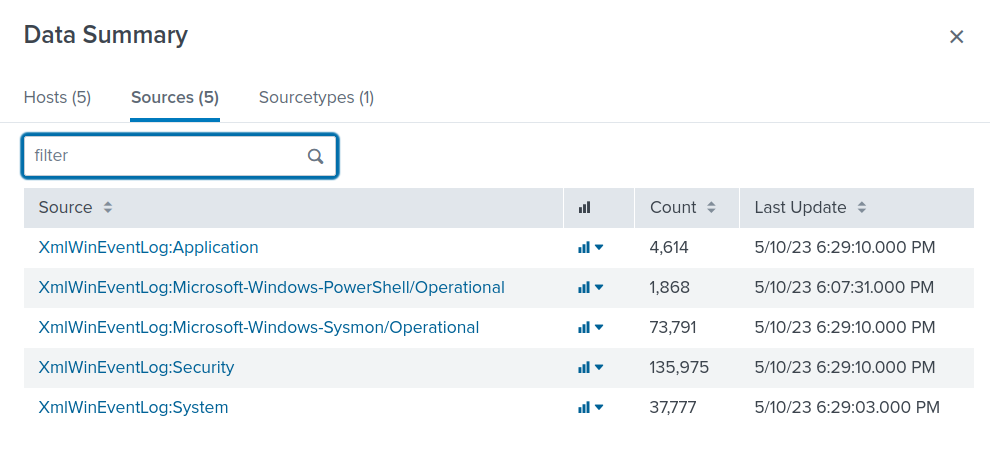

Initial searches establish the index and event coverage:

```spl
| eventcount summarize=false index=*
```

```spl
index=folks
| stats count min(_time) as first_seen max(_time) as last_seen by host source
| convert ctime(first_seen) ctime(last_seen)
| sort host source
```

The central event types are:

| Event source | Event ID | Investigative purpose |
|---|---:|---|
| Windows Security | 4624 | Logon success, type, identity, logon-session ID |
| Windows Security | 4768 | Kerberos TGT request on a domain controller |
| Windows Security | 4769 | Kerberos service-ticket request on a domain controller |
| PowerShell Operational | 4104 | PowerShell script-block content |
| Sysmon Operational | 1 | Process image, command line, parent, user, hashes, Logon ID |
| Sysmon Operational | 11 | File creation/overwrite and writing process |

**Timestamp handling.** Times in the tables below follow Splunk's displayed `_time` for the lab. Sysmon also includes `UtcTime` and the event XML has `TimeCreated`. Two 10 May `program.exe` records show `UtcTime` around **04:57:08** but XML `TimeCreated` around **04:57:36**; the precise field is called out wherever relevant.

---

## 2. Attack timeline

| Date / time | Host | Recorded event | Finding |
|---|---|---|---|
| 8 May, 07:03–07:09 | ABDULLAH | Security 4624 | Six Type 9 logons for `Administrator` using `Advapi`; distinct from the later `seclogo` set. |
| 9 May, 12:25:36 / 12:25:45 | CLIENT02 | Sysmon 1 | `C:\program.exe` executes as SYSTEM from `services.exe`, hash `F951…A2EA`. |
| **10 May, 03:28:41** | CLIENT02 | PowerShell 4104 | `Invoke-BloodHound` function appears in a script block. |
| **10 May, ~04:57:08** | CLIENT02 | Sysmon 1 (`UtcTime`) | Service-path interception again launches `C:\program.exe` as SYSTEM, now hash `8ACC…5BD2`. |
| **10 May, 05:08:57** | CLIENT02 | Sysmon 11 | PowerShell creates `C:\Users\HelpDesk\fun.exe`. |
| **10 May, 05:10:30** | CLIENT02 | Sysmon 1 | `fun.exe`, whose metadata identifies Mimikatz, is executed by HelpDesk. |
| **10 May, 05:49:10** | CLIENT02 | Sysmon 1 | Rubeus-like `asktgt /user:Mohammed /aes256:… /createnetonly:… /ptt`. |
| **10 May, 05:49:11** | ABDULLAH / CLIENT02 | Security 4768 / 4624 | Successful Mohammed TGT issuance; initial observed HelpDesk Type 9 `seclogo` session. |
| **10 May, 06:18:19** | CLIENT02 / ABDULLAH | Sysmon 1 / Security 4769 | S4U command impersonates Administrator toward `HTTP/Client03`; two successful TGS events for `Client02$`. |
| **10 May, 06:21:44** | CLIENT03 | Security 4624 + Sysmon 1 | Kerberos Type 3 Administrator logon and `wsmprovhost.exe` in the **same Logon ID**. |
| **10 May, 06:49:48** | CLIENT02 | Sysmon 1 + Security 4624 | Rubeus-style TGT request for `it-support` and Type 9 `seclogo` session. |
| **10 May, 07:16–07:19** | CLIENT02 | Sysmon 1 | Repeated Rubeus-style `asktgt` requests for Administrator with AES256 keys. |
| **10 May, 07:36:07** | CLIENT02 | Sysmon 1 | SafetyKatz `kerberos::golden` command specifies `trust_tgt.kirbi` for the parent domain. |
| **10 May, 07:44:42 / 07:51:24** | CLIENT02 | Sysmon 1 | Further ticket-forging commands reference `trust_tgt.kirbi` and `trust-test2.kirbi`. |
| **10 May, 08:09:36** | CLIENT02 | Sysmon 1 | `fun.exe` is launched with `lsadump::dcsync /user:Abdullah-work\Administrator`. |

The timeline is **not** an assertion that every observed event is malicious. The exploit-related events on 9 May and other earlier ticket requests need to be interpreted in context, not silently assigned to a single continuous attacker session.

---

## 3. NewCredentials logons — finding the initial account and host

A broad search for successful logons returned thousands of events. Restricting to **Logon Type 9** produced 12 events across two hosts:

```spl
index=folks EventCode=4624 Logon_Type=9
| table _time host TargetDomainName TargetUserName LogonProcessName \
        TargetOutboundUserName TargetOutboundDomainName SubjectLogonId TargetLogonId
| sort _time
```

| Host | Account | Count | Logon process | Observed dates |
|---|---|---:|---|---|
| ABDULLAH | `Abdullah-work\Administrator` | 6 | `Advapi` | 8 May |
| CLIENT02 | **`Abdullah-work\HelpDesk`** | **6** | **`seclogo`** | 10 May |

The earliest matching **`seclogo`** event occurred on **10 May at 05:49:11**, on **CLIENT02**. The earlier `Advapi` events should not be mistaken for the initial `seclogo`-based activity.

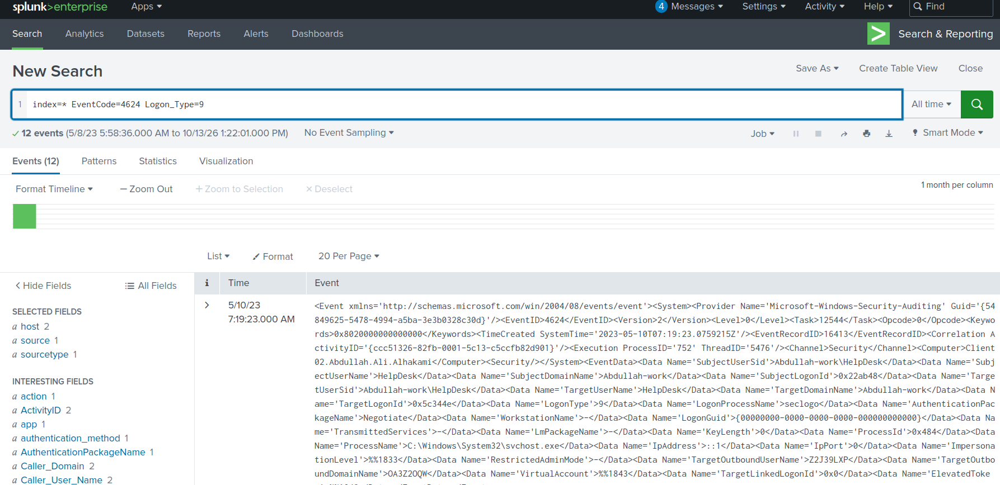

### Why Type 9 matters

**Type 9 — NewCredentials** creates a local security session while allowing separate credentials for later outbound connections. It is used legitimately by mechanisms such as `runas /netonly`. Its creation does **not** show that a remote machine accepted those credentials.

In the six HelpDesk events, the local account remains `HelpDesk`, but `TargetOutboundUserName` and `TargetOutboundDomainName` contain different seemingly generated values, for example:

```text
05:49:11  QSBL8AO5\DL7KFQY9
06:49:48  ZFF9NC8E\LZMMWK9A
07:15:17  3FSA5T4D\E7G29SPP
```

Such placeholder-like values are compatible with tooling that creates a NewCredentials session before manipulating network authentication material. They are **not proof** of NTLM pass-the-hash. `AuthenticationPackageName=Negotiate` is likewise not proof that NTLM was selected.

**Logon-session linkage:** The Type 9 event at 06:49:48 creates `TargetLogonId=0x504b8b`. A later Type 9 event at 07:15:17 has `SubjectLogonId=0x504b8b`, showing that the earlier session initiated another session. The process command lines discussed below provide further context for the `seclogo` events.

---

## 4. BloodHound PowerShell enumeration

On **10 May at 03:28:41**, CLIENT02 recorded a PowerShell **Event ID 4104** script block containing `function Invoke-BloodHound` and text describing a C# ingestor loaded in memory through reflection.

First inspect script-block telemetry:

```spl
index=folks host=CLIENT02 EventCode=4104
```

This produced **464 events**. Narrow to a distinctive tool signature:

```spl
index=folks host=CLIENT02 EventCode=4104
| search ScriptBlockText="*bloodhound*"
| table _time ScriptBlockText
```

The relevant script includes:

```powershell
function Invoke-BloodHound {
    <#
    .SYNOPSIS
    Runs the BloodHound C# Ingestor using reflection.
    #>
}
```

*The excerpt shows identifying lines, not the complete function implementation.*

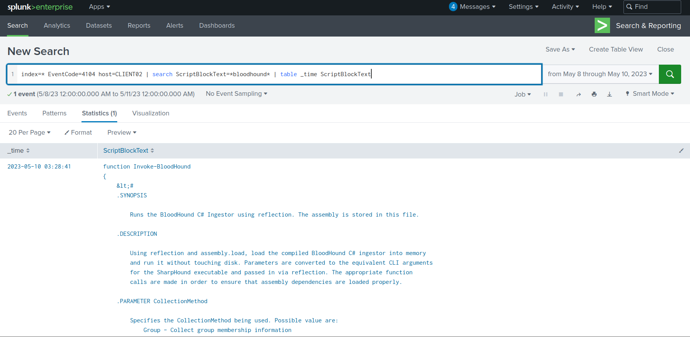

### The tools and their roles

**BloodHound** models AD object relationships and potential attack paths; **SharpHound** collects the data. In older collection workflows, `Invoke-BloodHound` provides a PowerShell wrapper around the C# ingestor. Other tools worth recognising include **PowerView** (PowerShell AD enumeration) and **ADRecon** (broader AD configuration collection).

When the tool name is unknown, investigate behaviour first: LDAP queries, `DirectorySearcher`, directory-related PowerShell functions, and enumeration of groups, users, trusts, sessions, or ACLs. Function names and code comments then help identify a particular toolkit.

**Evidence boundary:** Event 4104 confirms the script-block content was processed by PowerShell; a logged function *definition* alone does not prove `Invoke-BloodHound` was called or that collection completed.

---

## 5. Unquoted service path and privilege escalation

A distinctive Sysmon pattern on CLIENT02 shows a **different image executing from the command line's intended executable path**.

```spl
index=folks host=CLIENT02 CommandLine="C:\\Program Files\\*"
NOT Image="C:\\Program Files\\*"
| stats count by Image CommandLine
```

The search yielded four executions with the same discrepancy:

```text
Image           C:\program.exe
CommandLine     C:\Program Files\Basic Monitoring\Automate-Basic-Monitoring.exe
ParentImage     C:\Windows\System32\services.exe
User            NT AUTHORITY\SYSTEM
IntegrityLevel  System
```

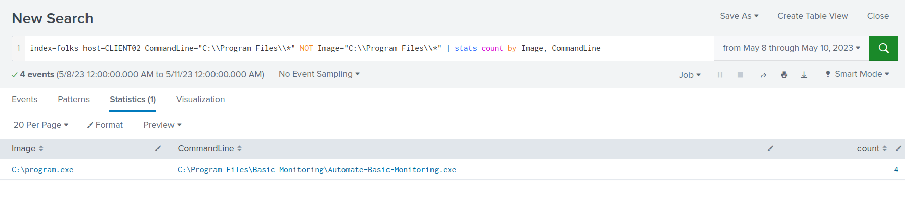

### Why an unquoted path is dangerous

If a service's executable path contains spaces but is not enclosed in quotes, Windows may resolve an unintended executable before the intended one. For example, an unquoted path:

```text
C:\Program Files\Basic Monitoring\Automate-Basic-Monitoring.exe
```

may result in Windows looking for candidates including:

```text
C:\Program.exe
C:\Program Files\Basic.exe
C:\Program Files\Basic Monitoring\Automate-Basic-Monitoring.exe
```

If an attacker can write a matching executable at an earlier candidate path and trigger a service launch, it can run with the service's privileges. Here the recorded parent is `services.exe` and **the actual executed image** is `C:\program.exe` with **SYSTEM** integrity. That is much stronger evidence of successful path interception than merely observing a potentially vulnerable unquoted configuration.

**Service-name limitation:** The log proves the affected **configured binary path**, not the registered Windows *service name*. The actual service name was not established from the shared service-configuration evidence; it would require correlation with service records (for example System 7045, when applicable, or `HKLM\SYSTEM\CurrentControlSet\Services\…\ImagePath`). An executable filename and a service name are not interchangeable.

---

## 6. Executable hashes and payload staging

### Two file contents at `C:\program.exe`

Four Sysmon Event ID 1 records show the same image path on different dates with **different SHA-256 values**:

| Executions | SHA-256 |
|---|---|
| 9 May, 12:25:36 and 12:25:45 | `F951F9FE207C2D9E412240BD0AEFF7233AB78712063EB1723DFAAA3B74BAA2EA` |
| 10 May, ~04:57 | **`8ACC5D98CFFE8FE7D85DE218971B18D49166922D079676729055939463555BD2`** |

```spl
index=folks host=CLIENT02 EventCode=1 Image="C:\\program.exe"
| rex field=Hashes "SHA256=(?<sha256>[A-Fa-f0-9]{64})"
| table _time UtcTime Image CommandLine ParentImage User IntegrityLevel sha256
| sort _time
```

A cryptographic hash fingerprints **file contents, not a file path**. These events establish that the executable contents differed; they do not tell us whether the binary was replaced, patched, or rebuilt. Both samples also share an **IMPHASH** (`B093B9B6223AF7F9E72D34D8765AA77F`), reflecting similar PE import characteristics rather than identical file contents.

### `fun.exe`: creation versus execution

```spl
index=folks host=CLIENT02 EventCode=11 TargetFilename="*fun.exe"
| table _time Image TargetFilename
| sort _time
```

At **10 May, 05:08:57**, Sysmon Event ID 11 recorded `powershell.exe` creating `C:\Users\HelpDesk\fun.exe`.

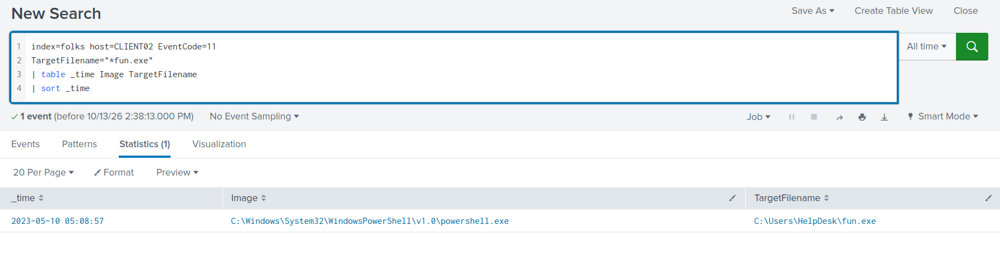

```spl
index=folks host=CLIENT02 EventCode=1 Image="*fun.exe"
| table _time Image CommandLine OriginalFileName Description Product User ParentImage Hashes
| sort _time
```

The first observed execution is **05:10:30**, approximately **93 seconds after file creation**. PE metadata identifies:

```text
Image             C:\Users\HelpDesk\fun.exe
OriginalFileName  mimikatz.exe
Description       mimikatz for Windows
Product           mimikatz
ParentImage       ...\powershell.exe
User              Abdullah-work\HelpDesk
SHA256            CFD90BF9CB627FB3574096B9D1C33522A46DB7412CD0FF42226474BF6A74CD77
```

**Sysmon 11 answers when a file appeared on disk; Sysmon 1 answers when it ran.** A FileCreate event is not by itself proof of an internet download—it may also represent a copy, extraction, or local write. The executable metadata is useful for recognising a renamed tool, but it can be changed by an adversary.

---

## 7. Mimikatz execution and DCSync

The attacker repeatedly executed the renamed `fun.exe` as HelpDesk. The command lines for earlier executions contain only the executable name; the **08:09:36** process creation event records an explicit command:

```spl
index=folks host=CLIENT02 EventCode=1 Image="*fun.exe"
| table _time Image CommandLine User ParentImage
| sort _time
```

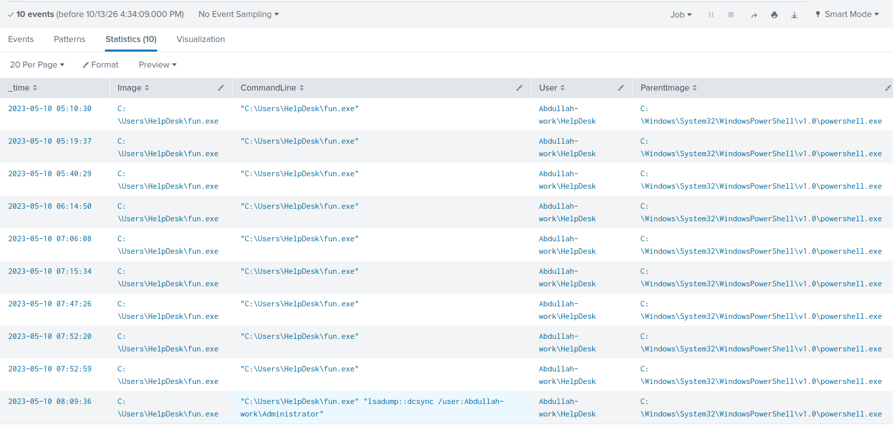

```text
"C:\Users\HelpDesk\fun.exe" "lsadump::dcsync /user:Abdullah-work\Administrator"
```

**`lsadump::dcsync`** is Mimikatz's command for requesting AD credential secrets using directory replication mechanisms. The `/user:` argument specifies the account whose secrets are requested. DCSync generally requires sufficiently privileged replication permissions; it does not require launching Mimikatz directly on the domain controller.

**What the event proves:** the program was started with a DCSync command directed at `Abdullah-work\Administrator`. It does not independently establish that the domain controller returned the secrets. Corroboration may include appropriately configured Security **4662** auditing of replication-access rights and directory replication evidence. Interactive commands typed after launching Mimikatz are not normally captured by Sysmon Event 1, which records the *process launch* command line.

**Mimikatz in context.** It is a credential and Kerberos manipulation toolkit, not a synonym for all malware. Key capabilities include LSASS credential access (`sekurlsa::logonpasswords`), pass-the-hash or pass-the-key (`sekurlsa::pth`), directory replication abuse (`lsadump::dcsync`), ticket import (`kerberos::ptt`), and ticket forging (`kerberos::golden`). See the [tool recognition reference](references/windows-ad-tools.md).

---

## 8. Kerberos key reuse: Mohammed and it-support

A process labelled `Microsoft-Update.exe`, executed under `Abdullah-work\HelpDesk`, used **Rubeus-style** command syntax to request Kerberos tickets with stolen or otherwise supplied AES256 key material.

```spl
index=folks host=CLIENT02 EventCode=1
| search CommandLine="*asktgt*"
| table _time Image User CommandLine
| sort _time
```

Observed activity includes:

| Time, 10 May | Target identity | Relevant command arguments |
|---|---|---|
| **05:49:10** | **Mohammed** | `asktgt /user:Mohammed /aes256:… /opsec /createnetonly:… /ptt` |
| 06:49:48 | it-support | `asktgt /user:it-support /aes256:… /opsec /createnetonly:… /ptt` |
| 07:16:39 onward | Administrator | Multiple `asktgt /user:Administrator /aes256:…` attempts |

For the first observed Mohammed command, the AES256 key specified in the process arguments is:

```text
facca59ab6497980cbb1f8e61c446bdbd8645166edd83dac0da2037ce954d379
```

### HelpDesk is the operator context; Mohammed is the target credential identity

`User=Abdullah-work\HelpDesk` in Sysmon identifies who ran the process locally. `/user:Mohammed` identifies whose Kerberos ticket Rubeus attempted to obtain. These accounts play different roles. A recorded command does not imply Mohammed personally operated CLIENT02.

Rubeus `asktgt` requests a TGT; `/aes256` supplies a Kerberos AES key; `/createnetonly` creates a NewCredentials process; `/ptt` requests that the ticket be imported. At **05:49:11**, one second after the command, CLIENT02 recorded a Type 9 `seclogo` session. The same pattern appears for **it-support** at **06:49:48**: the local Type 9 event still identifies **HelpDesk**, while the Rubeus command targets **it-support**.

### Did the Mohammed TGT request succeed?

Search the domain controller's **Security 4768** events:

```spl
index=folks EventCode=4768 "Mohammed"
| table _time host user TargetUserName IpAddress Status TicketEncryptionType
| sort _time
```

The relevant event at **05:49:11** reports:

```text
host                  ABDULLAH
TargetUserName        Mohammed
IpAddress             ::ffff:192.168.2.101
Status                0x0
TicketEncryptionType  0x12
```

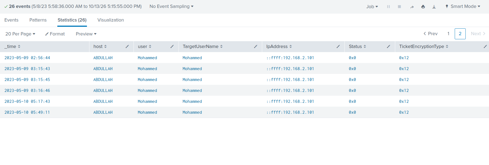

`Status=0x0` means the domain controller **issued a TGT for Mohammed**. The exact same-second correlation with the Rubeus command makes a connection likely; it is still useful to validate the source host of `192.168.2.101` before asserting origin beyond doubt.

**Ticket encryption types:** `0x11` = AES128, `0x12` = AES256, `0x17` = RC4-HMAC. These values in `TicketEncryptionType` describe the **issued ticket's encryption**, not necessarily the credential or pre-authentication key that the client supplied. An RC4 ticket by itself does not prove pass-the-hash or over-pass-the-hash. The strongest evidence here is the **Rubeus command containing `/aes256`**, corroborated by successful TGT issuance.

### Was Mohammed's ticket subsequently used?

```spl
index=folks EventCode=4769 "Mohammed"
| table _time host user ServiceName IpAddress Status TicketEncryptionType
| sort _time
```

A successful **4769** at **06:08:14** shows Mohammed requesting a service ticket associated with **`ABDULLAH$`**, with `Status=0x0` and `TicketEncryptionType=0x12`. That proves service-ticket issuance, **not** use at a destination or that this TGS was obtained with the specific 05:49 TGT. Earlier Mohammed TGTs also appear in the data. Separate 8 May RC4 (`0x17`) requests involving `it-support` are worth contextual examination, but not proof of Kerberoasting or direct evidence for the 10 May key-reuse command.

Mohammed is the **first observed `asktgt /aes256` identity** in the supplied 10 May command sequence, not the only account whose key is used. `it-support` and Administrator are subsequently targeted; the exercise's singular wording should not conceal these additional identities.

---

## 9. Kerberos delegation abuse targeting CLIENT03

The 10 May **06:18:19** Sysmon event on CLIENT02 contains a Rubeus-style `s4u` command executed as HelpDesk:

```spl
index=folks host=CLIENT02 EventCode=1
| search CommandLine="*Client03*"
| table _time Image User CommandLine
| sort _time
```

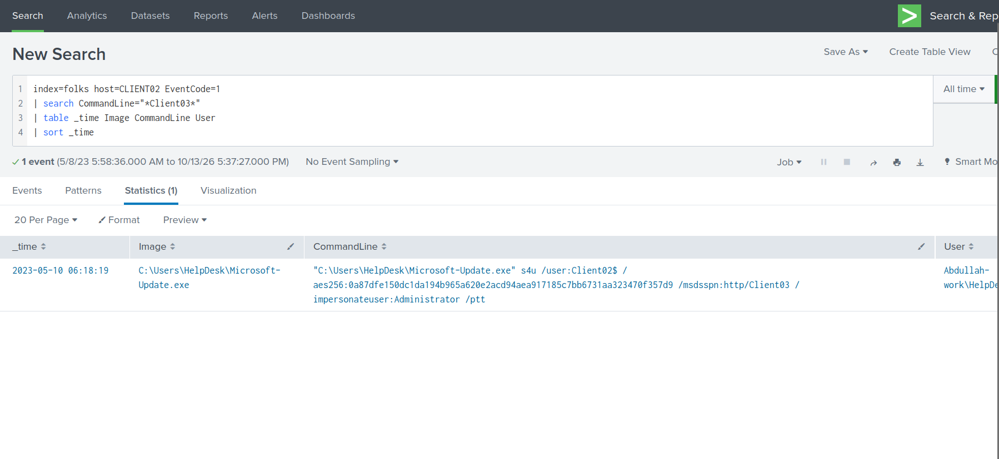

```text
"C:\Users\HelpDesk\Microsoft-Update.exe" s4u
/user:Client02$ /aes256:<key>
/msdsspn:http/Client03 /impersonateuser:Administrator /ptt
```

### Interpreting the SPN

A **Service Principal Name (SPN)** identifies a Kerberos service, commonly written as `service/host`. In `http/Client03`, `http` is the **service class** and `Client03` the **target host**. Other frequently encountered SPN service classes include `cifs` (SMB), `ldap` (directory service), `host` (host-associated services) and `MSSQLSvc` (SQL Server). `HTTP` is relevant to WinRM because Windows Remote Management uses HTTP or HTTPS as a transport, but the SPN alone does not identify the exact application or prove a connection succeeded.

`/user:Client02$` selects the machine principal whose key material is supplied; `/impersonateuser:Administrator` requests S4U ticket operations on behalf of Administrator; `/msdsspn:` gives the service principal targeted by the delegation workflow. This is strong evidence of an **attempted Kerberos delegation abuse**, without by itself proving a ticket usable as Administrator was obtained.

### Domain-controller corroboration

```spl
index=folks EventCode=4769
 earliest="05/10/2023:06:18:00" latest="05/10/2023:06:23:00"
| table _time host user ServiceName IpAddress Status TicketEncryptionType
| sort _time
```

At **06:18:19**, ABDULLAH recorded two successful service-ticket requests:

| Requesting principal | `ServiceName` | Source IP | Status | Ticket encryption |
|---|---|---|---|---|
| `Client02$@ABDULLAH.ALI.ALHAKAMI` | `CLIENT03$` | `192.168.2.101` | `0x0` | `0x12` |
| `Client02$@ABDULLAH.ALI.ALHAKAMI` | `CLIENT02$` | `192.168.2.101` | `0x0` | `0x12` |

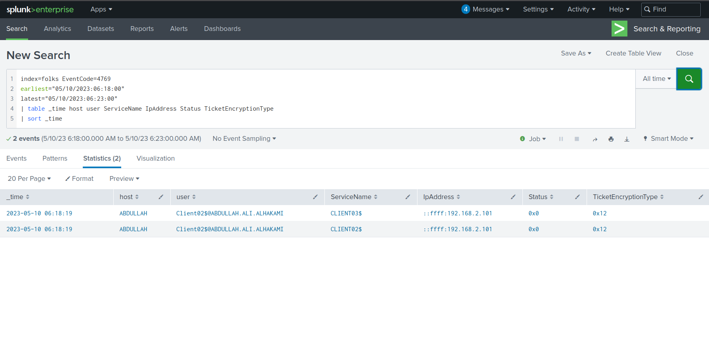

These events support the S4U sequence by principal, target and timing. The logs show `Client02$` as the requesting principal, **not** Administrator, and do not alone prove a ticket impersonating Administrator was issued. `CLIENT03$` is the target **machine account**, whereas `HTTP/Client03` is the SPN requested by the tool.

---

## 10. Confirming WinRM execution on CLIENT03

The S4U command points toward CLIENT03, but the stronger evidence of **successful remote administrative activity** comes from CLIENT03's own Security and Sysmon events.

### Process evidence

```spl
index=folks host=CLIENT03 EventCode=1
(Image="*wsmprovhost.exe" OR ParentImage="*wsmprovhost.exe")
| table _time User LogonId Image ParentImage ProcessGuid ParentProcessGuid CommandLine
| sort _time
```

The important process creation event is **10 May, 06:21:44**:

```text
Image          C:\Windows\System32\wsmprovhost.exe
CommandLine    C:\Windows\system32\wsmprovhost.exe -Embedding
User           Abdullah-work\Administrator
IntegrityLevel High
LogonId        0x23f77d3
ProcessGuid    {7394e7e8-37f8-645b-8e25-000000000800}
```

Other results show **`whoami.exe`** and **`HOSTNAME.EXE`** as children of `wsmprovhost.exe`, consistent with an operator checking identity and location within a remote PowerShell session.

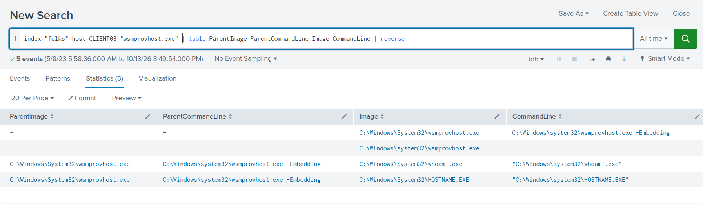

At **06:21:45**, Sysmon **11** records that same `wsmprovhost.exe` instance creating a `__PSScriptPolicyTest_*.ps1` file in Administrator's temporary directory. The matching **`ProcessGuid`** connects the file creation to the process. Such a temporary script policy test can be normal PowerShell behaviour; it is not itself malicious.

### Authentication-to-process correlation

Take `LogonId=0x23f77d3` from the Sysmon process and search CLIENT03's successful logons:

```spl
index=folks host=CLIENT03 EventCode=4624 TargetLogonId="0x23f77d3"
| table _time TargetUserName Logon_Type IpAddress AuthenticationPackageName TargetLogonId
| sort _time
```

The matching event at **06:21:44** shows:

| Security 4624 field | Recorded value |
|---|---|
| `TargetUserName` | `Administrator` |
| `Logon_Type` | **3 — Network** |
| `AuthenticationPackageName` | **Kerberos** |
| `TargetLogonId` | **`0x23f77d3`** |
| `IpAddress` | `-` (not populated) |

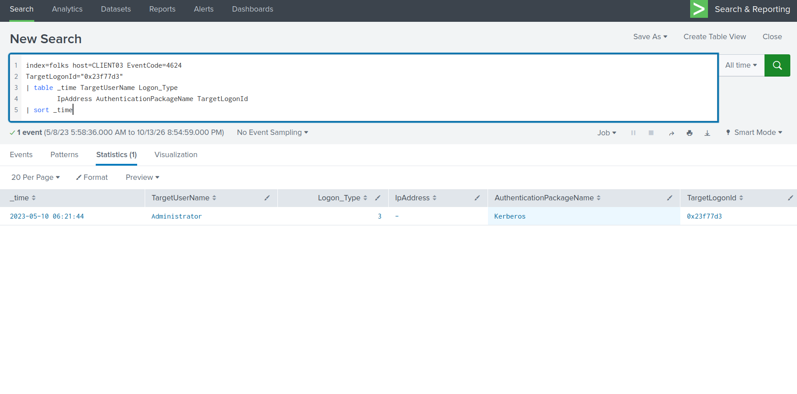

The matching Logon IDs on the **same host** link the successful Kerberos Administrator network logon to the `wsmprovhost.exe` process. Together with the process ancestry and the preceding HTTP-SPN S4U activity, this is strong evidence of WinRM/PowerShell remote administration on CLIENT03 as Administrator.

**Attribution limit:** The destination 4624 event has no source IP. Correlation strongly supports the preceding CLIENT02 attack sequence, but that particular authentication record does not independently prove CLIENT02 was the source. Identifying an IP in a 4769 event is not equivalent to matching the source IP of the eventual destination logon.

---

## 11. Forged tickets and access to the parent domain

The attacker later ran **`Better-to-trust.exe`** as HelpDesk on CLIENT02. Executable metadata identifies the renamed binary as **SafetyKatz** (`OriginalFileName=BetterSafetyKatz.exe`), a loader providing Mimikatz functionality.

A search for the output ticket file extension retrieved three process creation events:

```spl
index=folks "*.kirbi"
| table _time host EventCode Image OriginalFileName CommandLine User
| sort _time
```

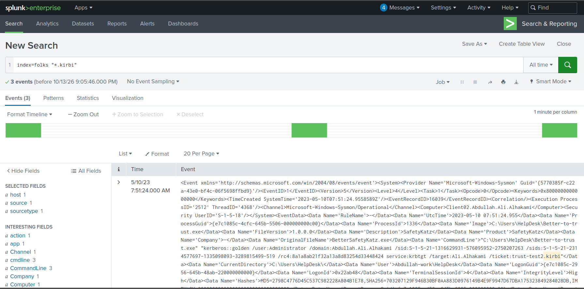

| Time, 10 May | Ticket filename in command | Crypto option |
|---|---|---|
| 07:36:07 | **`trust_tgt.kirbi`** | AES256 |
| 07:44:42 | **`trust_tgt.kirbi`** | RC4 |
| 07:51:24 | `trust-test2.kirbi` | RC4 |

The first command includes:

```text
"Better-to-trust.exe" "kerberos::golden
/user:Administrator
/domain:Abdullah.Ali.Alhakami
/sid:S-1-5-21-1316629931-576095952-2750207263
/sids:S-1-5-21-2314577697-1335098093-3289815499-519
/aes256:<key> /service:krbtgt
/target:Ali.Alhakami
/ticket:trust_tgt.kirbi"
```

*Arguments shown as a readable excerpt; the original log preserves the full command string and some options lack a slash in the recorded text.*

### Why trusts, SIDs and ticket files matter

The command invokes **`kerberos::golden`** for ticket forging, specifying `Administrator`, the child-domain identity context (`Abdullah.Ali.Alhakami`), an additional SID ending in **`-519`** (the well-known Enterprise Admins RID), and the parent-domain target **`Ali.Alhakami`**. In a multi-domain forest, trust relationships permit cross-domain Kerberos authentication; forged ticket material and injected SIDs can be used in attempts to gain privileges across those trust boundaries.

A **`.kirbi`** file is a commonly used representation of Kerberos ticket material. `/ticket:` specifies a desired output filename; `/ptt` requests ticket import into a session. The command lines establish **ticket-forging attempts and the specified output names**, not independently that files were written, accepted by the parent DC, or used to access it.

The primary filename associated with the observed parent-domain targeting commands is **`trust_tgt.kirbi`**. A separate later attempt specifies **`trust-test2.kirbi`**, which should be retained in the chronology rather than conflated with the earlier output.

---

## 12. Investigation results and remaining uncertainties

### Findings at a glance

| Investigation objective | Evidence-based result |
|---|---|
| Initial suspicious Type 9 / `seclogo` account | **`Abdullah-work\HelpDesk`** |
| Local compromised machine | **`CLIENT02`** |
| AD enumeration tool | **BloodHound** (`Invoke-BloodHound` script block) |
| Suspected vulnerable service binary | `C:\Program Files\Basic Monitoring\Automate-Basic-Monitoring.exe` — registered service name **not verified** |
| SYSTEM-level path-interception image / SHA-256 | `C:\program.exe` / **`8ACC5D98…555BD2`** on 10 May |
| `fun.exe` first file creation | **2023-05-10 05:08:57** (reported minute: **05:08**) |
| DCSync command | **`lsadump::dcsync /user:Abdullah-work\Administrator`** |
| Renamed `fun.exe` | **`mimikatz.exe`** |
| Earliest observed AES256 `asktgt` identity | **Mohammed** (`facca59a…54d379`) |
| Kerberos SPN targeting CLIENT03 | **`http/Client03`** |
| CLIENT03 remote-session host process | **`wsmprovhost.exe`** |
| `it-support`-related new credentials logon | **Type 9** (local session account: HelpDesk) |
| Parent-domain ticket output specified | **`trust_tgt.kirbi`**; later attempt: `trust-test2.kirbi` |

### What remains unverified

- **Service identification:** The recorded service binary path does not expose a registered service *name*; no service configuration record confirming that name was supplied.
- **PowerShell enumeration:** The `Invoke-BloodHound` definition was logged; successful collection was not independently confirmed.
- **DCSync outcome:** Mimikatz was launched with the command, but replication success and returned secrets were not shown.
- **Credential origin:** AES256 keys were used in process arguments; how the operator obtained them is not established.
- **Lateral-movement source:** The CLIENT03 logon-to-process match is firm, but its 4624 `IpAddress` is missing.
- **Parent-domain access:** Ticket-forging commands are visible; creation and successful use of a `.kirbi` ticket against `ALI` were not demonstrated.

The most reusable correlation in this case is **CLIENT03 Security 4624 `TargetLogonId` ↔ Sysmon 1 `LogonId`**. It links authentication to the process executing in the authenticated session. Process GUIDs similarly connect child processes and file writes; file hashes distinguish binary contents; and cross-host Kerberos events supply additional context without eliminating every attribution gap.

---

## 13. Technical references

- [Microsoft — Windows Security Event 4624 (logon types)](https://learn.microsoft.com/en-us/previous-versions/windows/it-pro/windows-10/security/threat-protection/auditing/event-4624)
- [Microsoft — Windows Security Event 4768 (Kerberos TGT)](https://learn.microsoft.com/en-us/previous-versions/windows/it-pro/windows-10/security/threat-protection/auditing/event-4768)
- [Microsoft — Windows Security Event 4769 (Kerberos service ticket)](https://learn.microsoft.com/en-us/previous-versions/windows/it-pro/windows-10/security/threat-protection/auditing/event-4769)
- [Microsoft Sysinternals — Sysmon events](https://learn.microsoft.com/en-us/windows/security/operating-system-security/sysmon/sysmon-events)
- [SpecterOps — BloodHound legacy collector reference](https://github.com/SpecterOps/BloodHound-Legacy/wiki/Data-Collector)
- [GhostPack — Rubeus](https://github.com/GhostPack/Rubeus)
- [MITRE ATT&CK T1574.009 — Unquoted path interception](https://attack.mitre.org/techniques/T1574/009/)
- [MITRE ATT&CK T1003.006 — DCSync](https://attack.mitre.org/techniques/T1003/006/)
- [MITRE ATT&CK T1558.001 — Golden Ticket](https://attack.mitre.org/techniques/T1558/001/)
- [Windows / AD tool recognition reference](references/windows-ad-tools.md)
