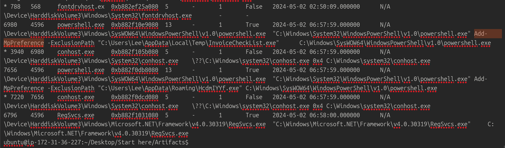
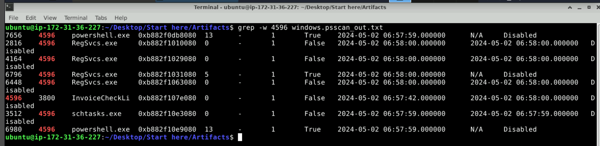

# Volatility Traces — Windows memory forensics

**CyberDefenders · Volatility 3 · Windows process analysis · Persistence · Microsoft Defender exclusions**  
**Evidence:** Windows memory image (`memory.dmp`) · **Volatility version in lab:** 3 Framework 2.7.0  
**Observed activity:** 2 May 2024, approximately 06:57:42–06:58:00 (timestamps as rendered by Volatility; time zone not established)

A Windows memory dump contained evidence of a suspicious executable spawning PowerShell, the Windows Task Scheduler utility, and multiple instances of a legitimate .NET registration tool. This walkthrough reconstructs the process relationships, explains the commands observed in memory, and separates what was recovered from what would require additional evidence to establish.

[CyberDefenders — Volatility Traces](https://cyberdefenders.org/blueteam-ctf-challenges/volatility-traces/)

## Contents

1. [Investigation summary](#1-investigation-summary)
2. [Reconstructing the process tree](#2-reconstructing-the-process-tree)
3. [Recovering the terminated parent and persistence lead](#3-recovering-the-terminated-parent-and-persistence-lead)
4. [PowerShell and Microsoft Defender exclusions](#4-powershell-and-microsoft-defender-exclusions)
5. [RegSvcs and the associated user account](#5-regsvcs-and-the-associated-user-account)
6. [ATT&CK mapping and evidence limits](#6-attck-mapping-and-evidence-limits)
7. [Answers and investigation takeaways](#7-answers-and-investigation-takeaways)
8. [Extending the investigation across an environment](#8-extending-the-investigation-across-an-environment)
9. [References](#9-references)

---

## 1. Investigation summary

The key findings from the supplied memory image are:

| Finding | Evidence | Assessment |
|---|---|---|
| Suspicious parent executable | `InvoiceCheckList.exe` accepted by the lab; `psscan` recovered PID 4596 with a truncated name and PPID 3800 | Identity corroborated by the lab and a matching process object |
| Two PowerShell child processes | PIDs **6980** and **7656**, both with PPID **4596** | Confirmed process relationships |
| Defender exclusion commands | `Add-MpPreference -ExclusionPath` in both PowerShell command lines | **Attempted** addition of two exclusion paths; outcome not verified |
| Scheduled-task utility | `schtasks.exe` PID **3512**, PPID **4596**, recovered with `psscan` | Persistence lead; task creation and its target were **not independently verified** |
| .NET registration utility | `RegSvcs.exe` PID **6796** active; other terminated `RegSvcs.exe` instances also recovered | Suspicious context; malicious assembly execution **not established** |
| Related username | `C:\Users\Lee\...` paths and accepted lab answer | `Lee` is the lab answer; token/SID or domain membership not independently validated |

The memory evidence supports **a suspicious execution chain and explicit attempts to change antivirus exclusions**. It does not, by itself, confirm that a scheduled task was successfully registered or the exclusions successfully applied.

## 2. Reconstructing the process tree

The initial command enumerated process relationships and available command lines:

```bash
../Tools/volatility3-develop/vol.py -f memory.dmp windows.pstree
```

Relevant output, abbreviated:

```text
PID   PPID  Process          Significant detail
3800  3764  explorer.exe     User shell
6980  4596  powershell.exe   Add-MpPreference -ExclusionPath ...\InvoiceCheckList.exe
7656  4596  powershell.exe   Add-MpPreference -ExclusionPath ...\HcdmIYYf.exe
6796  4596  RegSvcs.exe      C:\Windows\Microsoft.NET\Framework\v4.0.30319\RegSvcs.exe
```

Both PowerShell processes and `RegSvcs.exe` have **PPID 4596**. However, PID 4596 was absent from the `pstree` listing. This made recovering the missing parent the next step rather than guessing its executable from the child process names.



**Why use `pstree`?** It answers *which processes are related?* The parent-child relationship provides an investigative starting point, not automatic proof of maliciousness.

## 3. Recovering the terminated parent and persistence lead

A process scan had already been exported to `windows.psscan_out.txt`. We searched it for process records mentioning PID 4596:

```bash
grep -w 4596 windows.psscan_out.txt
```

Selected entries from the result (long columns removed):

```text
PID   PPID  ImageFileName     CreateTime             ExitTime
4596  3800  InvoiceCheckLi...  2024-05-02 06:57:42    2024-05-02 06:58:00
3512  4596  schtasks.exe      2024-05-02 06:57:59    2024-05-02 06:57:59
6980  4596  powershell.exe    2024-05-02 06:57:59    N/A
7656  4596  powershell.exe    2024-05-02 06:57:59    N/A
2816  4596  RegSvcs.exe       2024-05-02 06:58:00    2024-05-02 06:58:00
4164  4596  RegSvcs.exe       2024-05-02 06:58:00    2024-05-02 06:58:00
6448  4596  RegSvcs.exe       2024-05-02 06:58:00    2024-05-02 06:58:00
6796  4596  RegSvcs.exe       2024-05-02 06:58:00    N/A
```

`psscan` recovered the exited process **4596** as `InvoiceCheckLi...` (name truncated in output), with **PPID 3800**. The CyberDefenders Q1 answer confirmed the full name as **`InvoiceCheckList.exe`**. The scan also exposed terminated child processes that were absent from `pstree`.



Combined evidence yields this process relationship:

```text
explorer.exe (PID 3800)
└── InvoiceCheckList.exe (PID 4596; exited)
    ├── powershell.exe (PID 6980)
    ├── powershell.exe (PID 7656)
    ├── schtasks.exe (PID 3512; exited)
    ├── RegSvcs.exe (PID 2816; exited)
    ├── RegSvcs.exe (PID 4164; exited)
    ├── RegSvcs.exe (PID 6448; exited)
    └── RegSvcs.exe (PID 6796)
```

The `schtasks.exe` child is a strong **scheduled-task persistence lead**. It is the utility sought by Q2. To try to recover its original invocation, we ran:

```bash
../Tools/volatility3-develop/vol.py -f memory.dmp windows.cmdline --pid 3512
```

The command completed but returned only the headers (`PID`, `Process`, `Args`). Because the process had already exited, its command line was not recovered through this plugin. **No task name, trigger, creation command, or task target was established from that result.**

We also enumerated memory-resident registry hives:

```bash
../Tools/volatility3-develop/vol.py -f memory.dmp windows.registry.hivelist
```

The `SOFTWARE` hive appeared at offset `0xdb07714ca000`. We did **not** complete an examination of the scheduled-task registration keys. Finding the hive alone is not evidence of an established task.

**Memory-forensics lesson:** `windows.pstree` shows available process relationships; `windows.psscan` scans for process objects and can recover exited or unlinked processes. The latter was decisive here.

## 4. PowerShell and Microsoft Defender exclusions

The active PowerShell processes contained these command lines:

**PID 6980**

```powershell
Add-MpPreference -ExclusionPath "C:\Users\Lee\AppData\Local\Temp\InvoiceCheckList.exe"
```

**PID 7656**

```powershell
Add-MpPreference -ExclusionPath "C:\Users\Lee\AppData\Roaming\HcdmIYYf.exe"
```

`Add-MpPreference` is a Microsoft Defender PowerShell cmdlet; `-ExclusionPath` adds a specified file or folder path to antivirus exclusions. In this context, both commands are suspicious because they attempt to exempt executables connected to the suspicious process chain from scanning.

The two paths are:

```text
C:\Users\Lee\AppData\Local\Temp\InvoiceCheckList.exe
C:\Users\Lee\AppData\Roaming\HcdmIYYf.exe
```

**Evidence limit:** Process command-line text proves that the commands were invoked or intended for execution. It does **not** prove that Defender accepted the changes. Verification would require Defender configuration or other corroborating telemetry.

## 5. RegSvcs and the associated user account

The same parent process spawned multiple `RegSvcs.exe` instances. One remained listed as active in `pstree`:

```text
PID 6796   PPID 4596   RegSvcs.exe
C:\Windows\Microsoft.NET\Framework\v4.0.30319\RegSvcs.exe
```

`RegSvcs.exe` is a legitimate Microsoft .NET Framework tool for registering assemblies as COM+ components. It can also be abused to proxy malicious code execution through a trusted binary. In this case, the **parent process, timing, repeated launches, and accompanying Defender-exclusion attempts** justify further examination. They do **not** establish which assembly was registered or whether malicious code ran inside `RegSvcs.exe`.

The user name **Lee** appears repeatedly in paths contained in the command lines. It was also accepted as the correct answer to Q7. A full account assessment—including whether the account is local or domain-based, the process token, and privileges—would require additional evidence such as process SIDs/tokens and system account records. Paths alone are not sufficient for those claims.

## 6. ATT&CK mapping and evidence limits

| Technique | Application to this case | Confidence / limitation |
|---|---|---|
| [T1564.012 — File/Path Exclusions](https://attack.mitre.org/techniques/T1564/012/) | **Lab's accepted answer** for the exclusion-related behaviour | Commands targeting two exclusions are visible; application of settings was not confirmed |
| [T1053.005 — Scheduled Task](https://attack.mitre.org/techniques/T1053/005/) | `schtasks.exe` launched by the suspicious parent | **Candidate** mechanism; task creation not independently confirmed |
| [T1218.009 — Regsvcs/Regasm](https://attack.mitre.org/techniques/T1218/009/) | `RegSvcs.exe` launched by the suspicious parent | **Candidate** abuse; no assembly/payload evidence recovered |

**ATT&CK taxonomy nuance:** The lab expects **T1564.012**. Current ATT&CK wording distinguishes hiding payloads in existing excluded locations from **modifying a security tool to add exclusions**. The latter is also relevant to *Disable or Modify Tools* ([T1685](https://attack.mitre.org/techniques/T1685/); formerly T1562.001). Use the observed action and the version of ATT&CK in force when reporting rather than mapping solely from a lab answer.

## 7. Answers and investigation takeaways

| # | Question focus | Answer | How obtained |
|---|---|---|---|
| 1 | Parent process of two PowerShell processes | `InvoiceCheckList.exe` | `pstree` common PPID; `psscan` recovered terminated PID 4596; full name confirmed by lab |
| 2 | Executable associated with persistence | `schtasks.exe` | `psscan` found PID 3512 under PPID 4596 |
| 3 | Additional active suspicious child | `RegSvcs.exe` | `pstree` found PID 6796 under PPID 4596 |
| 4 | PowerShell defence-evasion cmdlet | `Add-MpPreference` | PowerShell command-line text in `pstree` |
| 5 | Two paths targeted by exclusions | `InvoiceCheckList.exe`, `HcdmIYYf.exe` | `-ExclusionPath` arguments |
| 6 | File/path exclusions sub-technique | `T1564.012` | MITRE ATT&CK mapping requested by the lab |
| 7 | Associated user | `Lee` | User profile paths; lab-confirmed answer |

**What made this investigation efficient:**

- Start with the specific question and the evidence already collected; don't expand a straightforward question into an unrelated forensic workflow.
- When a parent PID is missing from the active process tree, pivot to `psscan` rather than assuming the process never existed.
- Separate **tool execution** (`schtasks.exe` observed) from **outcome** (a persistent task created). Do the same for attempted Defender changes.
- Treat legitimate system utilities such as `RegSvcs.exe` as suspicious **in context**, not inherently malicious.

## 8. Extending the investigation across an environment

This lab used one memory image. In a real member-support investigation, the next question would be **how many other endpoints were affected?** A single-host memory dump cannot answer that.

Prioritise the following pivots in SIEM/EDR and endpoint telemetry:

| Hunting question | Useful evidence |
|---|---|
| Which hosts executed `InvoiceCheckList.exe` or `HcdmIYYf.exe`? | EDR process telemetry; Sysmon Event ID 1; Security Event ID 4688 if enabled; ideally hashes and full image paths |
| Did other endpoints attempt the same exclusion changes? | Process command lines containing `Add-MpPreference` and `-ExclusionPath`; Defender configuration/change telemetry |
| Was persistence established? | Scheduled-task registration/configuration and process-creation telemetry; Security Event ID 4698 where audited; Task Scheduler Operational events |
| Was `RegSvcs.exe` abused? | Parent/child process telemetry, loaded modules, assembly paths, relevant EDR alerts |
| Did related hosts communicate with external infrastructure? | EDR network connections, Sysmon Event ID 3 if enabled, DNS logs, proxy logs, PCAPs |

Example **starting-point** Splunk hunt (adjust index, source type, field names, and endpoint identifiers to the member's telemetry):

```spl
index=<WINDOWS_INDEX> EventCode=1
(Image="*\\InvoiceCheckList.exe" OR Image="*\\HcdmIYYf.exe"
 OR ParentImage="*\\InvoiceCheckList.exe")
| stats count min(_time) as first_seen max(_time) as last_seen
        values(User) as users values(CommandLine) as command_lines
        by host Image
| convert ctime(first_seen) ctime(last_seen)
```

This query looks for **process execution evidence**, not mere file presence or download. A filename-based search is only the first pass; verify with hashes, full paths, ancestry, and related behaviours. The resulting host count is bounded by **coverage and retention**: endpoints without the required telemetry cannot be treated as unaffected.

For member reporting, distinguish **observed executions**, **hosts with suspicious artifacts**, and **hosts with confirmed malicious activity**. Those are not necessarily the same set.

## 9. References

- [CyberDefenders — Volatility Traces](https://cyberdefenders.org/blueteam-ctf-challenges/volatility-traces/)
- [Volatility 3 documentation](https://volatility3.readthedocs.io/)
- [Microsoft Learn — Add-MpPreference](https://learn.microsoft.com/en-us/powershell/module/defender/add-mppreference)
- [MITRE ATT&CK — File/Path Exclusions (T1564.012)](https://attack.mitre.org/techniques/T1564/012/)
- [MITRE ATT&CK — Scheduled Task (T1053.005)](https://attack.mitre.org/techniques/T1053/005/)
- [MITRE ATT&CK — Regsvcs/Regasm (T1218.009)](https://attack.mitre.org/techniques/T1218/009/)
- [MITRE ATT&CK — Disable or Modify Tools (T1685)](https://attack.mitre.org/techniques/T1685/)
